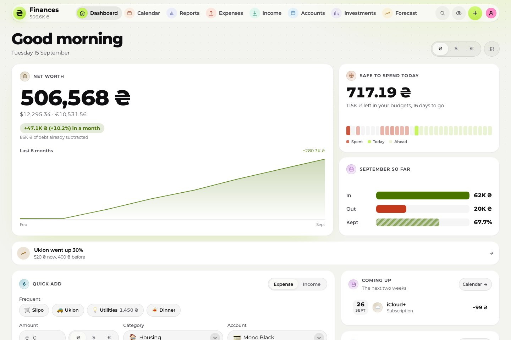
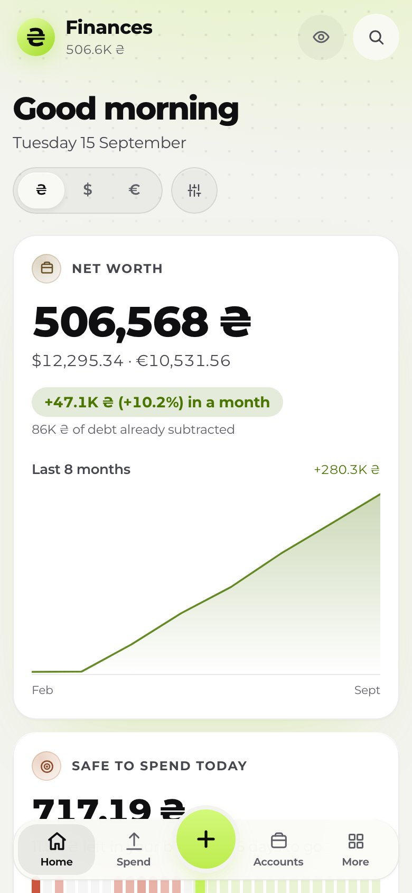
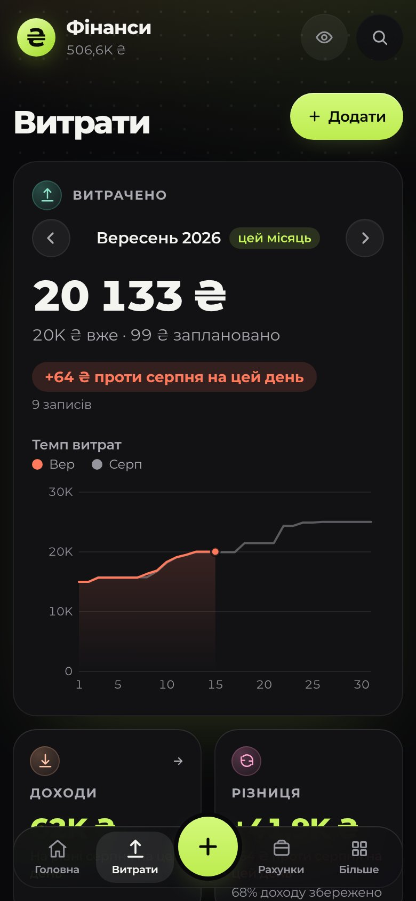
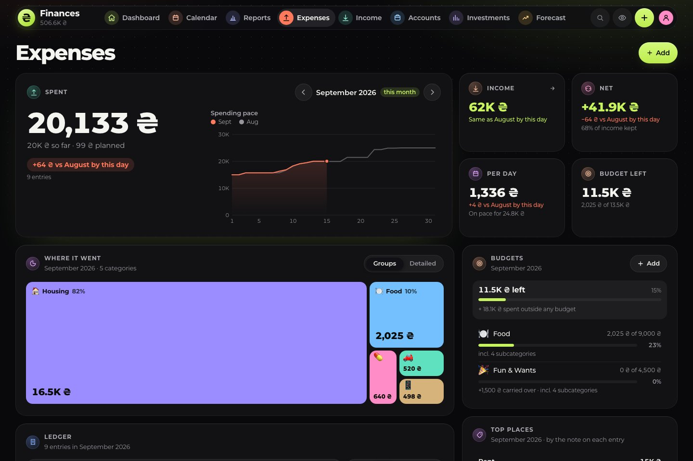
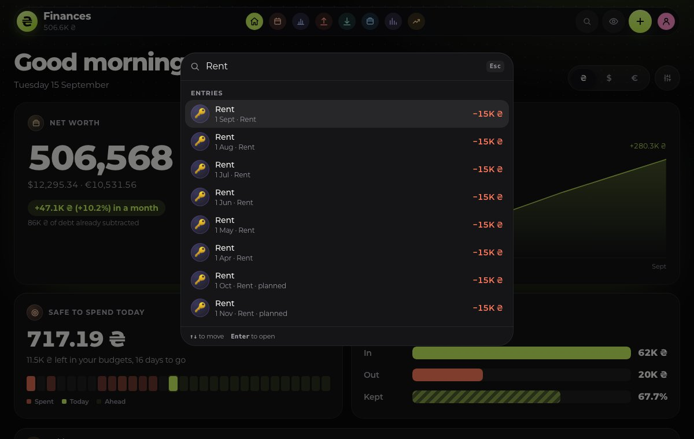

# 💰 Finance

[](https://github.com/sacrificed666/finance/actions/workflows/ci.yml)
[](https://github.com/sacrificed666/finance/actions/workflows/codeql.yml)

A self-hosted personal finance tracker for people who keep their money in more than one currency. Track income, spending, subscriptions, accounts, debts and investments in ₴, $ and €, watch your net worth build up by itself and project it years ahead. Built with Next.js 16, React 19, TypeScript 7 and PostgreSQL, in ten languages, accessible, light or dark, with every record sealed in your own database.

<picture>
  <source media="(prefers-color-scheme: dark)" srcset="./docs/images/desktop-dark.jpg" />
  
</picture>

## ✨ Highlights

- 📊 **Dashboard**: net worth from daily snapshots, this month against the last, quick add, cash flow, spending with every budget, cash ahead for the next 30 or 60 days, in a layout you arrange
- 💸 **Expenses**: a ledger with search, saved views, filters, tags, split purchases, receipt photos and QR scans, bulk edit and CSV export, recurring rules and instalments, subscriptions with a real lifetime and budgets with rollover and pace
- 🧾 **Income and taxes**: a day-rate calculator, tax per entry for every FOP group or a regime of your own, the annual limit, a tax calendar, a quarterly summary at the NBU rate of the day and the income book
- 🏦 **Accounts**: derived balances checked against Monobank, cryptocurrency and game item accounts, savings goals, credit card grace periods, debts with a payoff planner and money owed to you
- 📈 **Investments and forecast**: deposits, bonds, funds, stocks and coins that each earn the right way, Inzhur funds, and a projection up to 40 years ahead with three scenarios, a goal and a wishlist
- 🏦 **Bank import**: Monobank directly or through its webhook, any CSV statement or a Monefy, Spendee or Wallet export, with categories and names learned from your corrections, a queue to review, transfers paired and duplicates skipped
- 💱 **Live rates**: exchange rates and coin prices refresh by themselves every hour, and past months count at their own average rate
- 🔔 **Notifications**: a short note each morning of what is due, new bank operations and budgets at 80 % and 100 %, encrypted end to end, and a private link for your calendar app
- 🔐 **Private**: passkeys, two-step verification, sign-out everywhere, every record sealed with AES-256-GCM, and nothing readable leaves your server unless you make a calendar link
- 💾 **Never loses an edit**: saves send only what changed, merge between devices and wait in the browser while the server cannot be reached
- 🌍 **Ten languages**: English, Ukrainian, Czech, German, Spanish, French, Italian, Dutch, Polish and Portuguese, including money, dates, plurals and spreadsheets
- ♿ **Accessible**: landmarks, a skip link, native dialogs, a combobox command palette, a table behind every chart, reflow down to 320 px and support for reduced motion, reduced transparency and forced colours, checked with axe in every build

<p align="center">
  
  
</p>





## ⚛️ Front-end


## 🗄️ Back-end


## 🧰 Tooling


TypeScript 7 · Oxlint · Oxfmt · Vitest 5 · Testing Library · Playwright · PGlite · axe · Lighthouse · React Compiler · Auth.js · SimpleWebAuthn · CodeQL

## 🚀 Quick start

Requires **Node.js 24** or newer (26, the newest line, is recommended in `.nvmrc`) and, to keep your data, **Docker**.

```bash
make setup                   # packages, .env with fresh keys, the test browsers and the Git hooks
make dev-up                  # the dev server and Postgres in Docker: http://localhost:3000
```

Create your account on `/register`. Every account sees only its own data; set `OWNER_EMAIL` in `.env` to let only you sign up (staging and production stay closed to sign-ups without it).

> [!TIP]
> No Docker? `make dev-db` runs the dev server on a throwaway Postgres in memory, the same one the end-to-end tests use. Everything in it is gone when it stops.

```bash
npm run check                # lint, the dash check, format check, type check and unit tests in one go
npm run test:e2e             # browsers, accessibility and Lighthouse on a throwaway database
make help                    # every command, grouped by environment
```

🐳 Staging and production run in Docker too, each with its own database, keys and nightly backups, see [Deployment](./docs/deployment.md):

```bash
make env ENV=production      # .env.production with fresh keys; then set AUTH_URL and OWNER_EMAIL
make prod-up                 # the production build and Postgres in the background
```

## 📚 Documentation

| Guide                                                       | Topics                                                               |
| ----------------------------------------------------------- | -------------------------------------------------------------------- |
| 🏁 [Getting started](./docs/getting-started.md)             | Requirements, environment variables, scripts and layout              |
| ✨ [Features](./docs/features.md)                           | Everything the app can do, page by page                              |
| 🏗️ [Architecture](./docs/architecture.md)                   | Layers, the client store, API routes, the database and the maths     |
| 🗃️ [Data model](./docs/data-model.md)                       | `AppState`, the schema, normalization and backups                    |
| 💱 [Money and currencies](./docs/money-and-currencies.md)   | Rates, past months, conversion and formatting                        |
| 🧾 [Taxes](./docs/taxes.md)                                 | FOP groups, VAT, custom regimes, limits and the tax calendar         |
| 🏦 [Accounts and assets](./docs/accounts-and-assets.md)     | Account kinds, cryptocurrency, game items, debts and logos           |
| 📈 [Investments](./docs/investments.md)                     | Return types, Inzhur funds and live prices                           |
| 🗓️ [Budgets and schedules](./docs/budgets-and-schedules.md) | Categories, budgets, recurring rules and subscriptions               |
| 🏦 [Bank import](./docs/bank-import.md)                     | Monobank, CSV statements, rules, transfers and duplicates            |
| 🔮 [Forecast](./docs/forecast.md)                           | The projection, scenarios, goals and the wishlist                    |
| 🔔 [Notifications](./docs/notifications.md)                 | The morning note, instant notes and delivery                         |
| 🎮 [Gamification](./docs/gamification.md)                   | XP, levels, achievements and the health score                        |
| 🎨 [Design system](./docs/design.md)                        | Tiles, layout, tokens, charts and motion                             |
| 🌍 [Localization](./docs/i18n.md)                           | How the language is chosen, messages, formatting, adding a language  |
| ♿ [Accessibility](./docs/accessibility.md)                 | Semantics, keyboard, screen readers, contrast and reflow             |
| 🔎 [SEO](./docs/seo.md)                                     | Kept out of search engines, titles and the installed app             |
| 🛡️ [Security](./docs/security.md)                           | Sign-in, sealed records, the CSP, validation and supply chain        |
| 🧪 [Testing](./docs/testing.md)                             | Unit and browser tests, the throwaway database, axe and Lighthouse   |
| 🚀 [Deployment](./docs/deployment.md)                       | Docker environments, settings, schema changes, backups and the proxy |
| 🏷️ [Releases](./docs/releases.md)                           | Versions, branches, the changelog and environments                   |
| 🤝 [Contributing](./docs/contributing.md)                   | Workflow, code style and commit conventions                          |
| ❓ [FAQ](./docs/faq.md)                                     | Common questions                                                     |

## 📌 Good to know

- 🏠 **Self-hosted, no domain of its own.** The app runs wherever you put it; `AUTH_URL` is its address, and Monobank's webhook needs it on `https:`.
- 🔒 **Your records are sealed.** Every row in Postgres is AES-256-GCM ciphertext under `DATA_ENCRYPTION_KEY`; a database dump shows that rows exist, not what is in them.
- 💱 **Past months keep their rate.** Income and spending count at the NBU's average rate of their month, balances and net worth at today's.
- 🧾 **Taxes are opt-in.** A new account has no tax regime; **Settings → Taxes** sets one, with ЄСВ on or off.

> [!CAUTION]
> Keep `DATA_ENCRYPTION_KEY` in a password manager, apart from your backups. Without it the records cannot be read by anyone, you included.

## ✍️ Author

**[Illia Movchko](https://github.com/sacrificed666)**

## 🙏 Credits

- **[Monobank](https://api.monobank.ua/docs/)**, **[NBU](https://bank.gov.ua/ua/open-data/api-dev)** and **[CoinGecko](https://www.coingecko.com/en/api)**: exchange rates, statements and coin prices
- **[Inzhur](https://www.inzhur.reit)**: published fund figures
- **[country-flag-icons](https://gitlab.com/catamphetamine/country-flag-icons)**: language flags, served by the app itself
- **[PGlite](https://pglite.dev)**: the throwaway Postgres of the tests and `make dev-db`
- **[Montserrat](https://github.com/JulietaUla/Montserrat)**: the typeface, under the SIL Open Font License

## 📝 License

Licensed under the **[MIT License](https://choosealicense.com/licenses/mit/)**.
