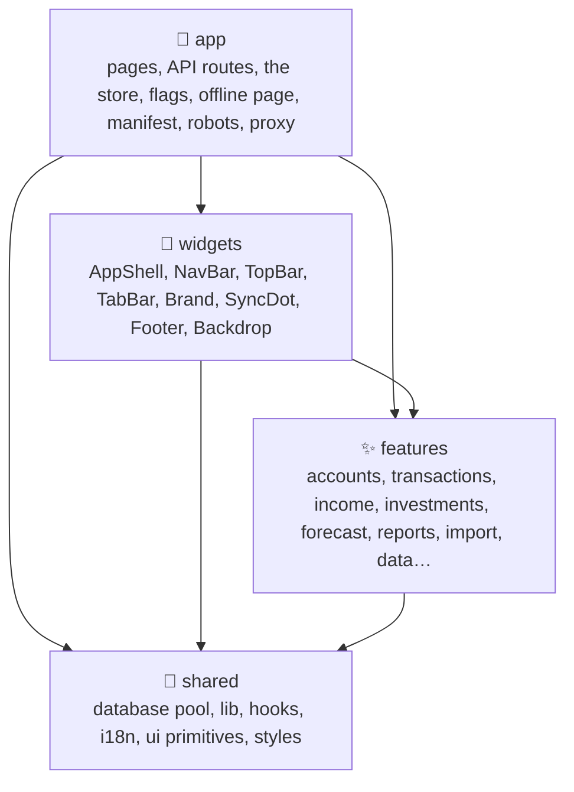
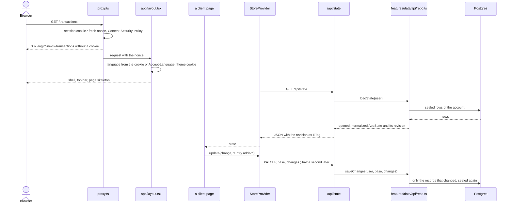
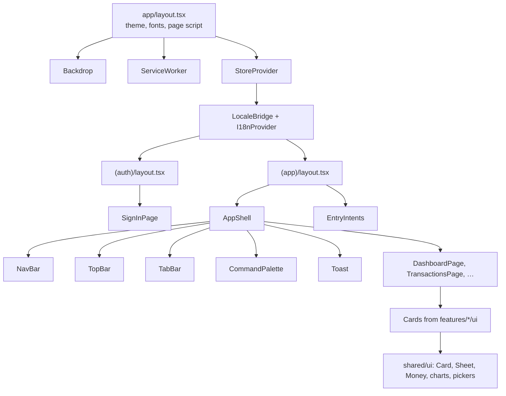

# 🏗️ Architecture

## 🧱 Technology stack

| Area         | Choice                                                                                                    |
| ------------ | --------------------------------------------------------------------------------------------------------- |
| ⚛️ UI        | React 19.3 with the React Compiler (automatic memoization)                                                |
| 🧭 Framework | Next.js 16 App Router: route handlers, `proxy.ts`, `instrumentation.ts`, the standalone output, Turbopack |
| 🐘 Data      | PostgreSQL 18 through `pg`, every record sealed with AES-256-GCM; the schema in `db/schema.sql`           |
| 🔐 Auth      | Auth.js 5 with JWT sessions, passwords, passkeys through SimpleWebAuthn, TOTP and optional Google         |
| 🌍 i18n      | Ten hand-written message catalogs on top of `Intl` for money, numbers, dates and plurals                  |
| 🎨 Styling   | Sass modules, CSS custom properties, `color-mix()`, `:has()`, container queries, native `<dialog>`        |
| 🔷 Language  | TypeScript 7 in strict mode with `noUncheckedIndexedAccess`, `verbatimModuleSyntax` and route types       |
| ✅ Quality   | Oxlint (type-aware, React Compiler, Next.js, a11y and layer rules), Oxfmt, Vitest 5, Testing Library      |

## 🧭 Layers

The source is organised by **feature**, in four layers. A layer may only import from the layers below it, and Oxlint's `no-restricted-imports` rule enforces this in `.oxlintrc.json`.

| Layer       | Folder                                              | Contains                                                   | May import                                        |
| ----------- | --------------------------------------------------- | ---------------------------------------------------------- | ------------------------------------------------- |
| 🚀 App      | `src/app`, `src/proxy.ts`, `src/instrumentation.ts` | Next.js routes and special files, the client store         | everything                                        |
| 🧩 Widgets  | `src/widgets`                                       | The frame every signed-in page shares                      | features, shared, the store hooks and types       |
| ✨ Features | `src/features`                                      | One folder per area with a `model/`, an `api/` and a `ui/` | other features, shared, the store hooks and types |
| 🧰 Shared   | `src/shared`                                        | Helpers and UI that know nothing about money               | shared only                                       |

Inside a feature, `model/` holds pure logic and the hooks that read the store, `api/` the code that runs on the server or talks to an outside service, and `ui/` one folder per page, card or sheet.

| Feature            | Model and API                                                                                                                                | UI                                                                                      |
| ------------------ | -------------------------------------------------------------------------------------------------------------------------------------------- | --------------------------------------------------------------------------------------- |
| 🗄️ `data`          | `AppState` types, defaults, `normalizeState()`, change sets, balances and net worth (`finmath.ts`), the outbox; the repository and resealing | none                                                                                    |
| 🏠 `dashboard`     | The month summary, cash ahead, net worth history and snapshots, the card layout                                                              | `DashboardPage` and its cards, `LayoutSheet`                                            |
| 💳 `transactions`  | Ledger, categories, budgets and pace, recurring rules, subscriptions, schedules, receipts; attachments on the server                         | `TransactionsPage`, `LedgerCard`, `TransactionSheet`, `EntryIntents`, budgets and plans |
| 💼 `income`        | Income records, tax regimes and figures by year, the tax calendar, NBU rates for past months                                                 | `IncomePage`, `IncomeSheet`, quarterly tax, tax calendar and limit cards                |
| 🏦 `accounts`      | Account kinds, brands, coins and game items, debts and payoff plans, receivables, goals, reconciling                                         | `AccountsPage`, account, debt and receivable sheets, bank check                         |
| 📈 `investments`   | Positions, return types, schedules, Inzhur funds; the Inzhur scraper on the server                                                           | `InvestmentsPage`, `InvestmentSheet`, allocation and schedule cards                     |
| 🔮 `forecast`      | The projection, goal and wishlist, planned events                                                                                            | `ForecastPage`, assumptions, projection, yearly table, wishlist                         |
| 📊 `reports`       | The period report, CSV export, labels                                                                                                        | `ReportsPage`, trends, changes, largest, tags, year in review                           |
| 📅 `calendar`      | Every dated event of a month                                                                                                                 | `CalendarPage`, `MonthGrid`, `DayCard`, key dates, weeks                                |
| 📥 `import`        | CSV parsing, matching, duplicates and transfer pairing; Monobank statements and webhooks on the server                                       | `ImportCard`, `CsvSheet`, `ImportPreviewSheet`                                          |
| 💱 `market`        | Hourly refresh of rates and prices, month averages; Monobank, NBU and CoinGecko clients                                                      | `PricesFootnote`                                                                        |
| 🔔 `notifications` | Web Push with VAPID, the morning note and its clock, alerts, the offline page; the browser subscription                                      | `NotificationsCard`, `ServiceWorker`                                                    |
| 👤 `profile`       | Achievements, badges, profile fields; the profile repository, passkeys, two-step verification and sessions                                   | `ProfilePage`, details, sign-in, passkeys and two-step sheets, achievements             |
| 🔐 `auth`          | Auth.js configuration, accounts, passwords and their meter, TOTP, passkeys, sign-ins, sessions                                               | `SignInPage`, `PasswordField`                                                           |
| ⚙️ `settings`      | Preferences, taxes, categories and rules, rates, the server error log                                                                        | `SettingsPage`, general, categories, rules, rates, data, server errors                  |
| ⌨️ `commands`      | The command palette's commands                                                                                                               | `CommandPalette`, `PaletteButton`, `PaletteDialog`                                      |

## 🔀 Request flow

- 🧠 **One state, computed on the client.** Everything financial lives in one `AppState` object. Pages are client components that read it from the store and derive every number with pure functions in a `model/` folder, so every screen agrees and the maths is easy to test. A page never fetches a number of its own.
- 🌍 **Rendered in the right language.** The root layout is `async`: it reads the language cookie and `Accept-Language`, so the shell renders on the server in the right language and theme. That makes every route dynamic by design. `LocaleBridge` then follows the language saved in the account, so it moves with the person across devices.
- 🧯 **Failures stay inside the frame.** A page that breaks while it draws is replaced by `(app)/error.tsx` inside the app's frame, with **Try again** and the way to the overview, and the failure goes to the owner's **Server problems**; a failure of the frame itself falls back to `global-error.tsx`, a plain page in the account's language. Both and the database message share `widgets/ProblemPanel`.
- 🔒 **Two gates.** `proxy.ts` sends a browser without a session cookie to `/login`; every route handler checks the session itself with `auth()`, see [Security](./security.md#-request-authorisation).

## 🧠 The client store

`src/app/StoreProvider.tsx` owns all financial data; features read it with `useStore()` and `useSyncStatus()` from `src/app/hooks.ts`.

| Concern           | How it works                                                                                                                                                                                                                                                                                                                                                                                                                                                              |
| ----------------- | ------------------------------------------------------------------------------------------------------------------------------------------------------------------------------------------------------------------------------------------------------------------------------------------------------------------------------------------------------------------------------------------------------------------------------------------------------------------------- |
| Load              | `GET /api/state` once a signed-in page shows                                                                                                                                                                                                                                                                                                                                                                                                                              |
| Save              | Half a second after the last edit, `PATCH /api/state` sends only what changed since the last save (`features/data/model/changes.ts`): new records whole, and for an edited record or the settings only the fields that changed, with single keys of `taxPaid`, `monthRates` and `bankLinks`                                                                                                                                                                               |
| Other devices     | Saves of one account queue behind each other (`SELECT … FOR UPDATE` on its settings row) and merge on the server field by field, so a tab that changes the rates never undoes a tax marked paid on another device. A save built on an older revision comes back `stale`, and the tab pulls the newer state and lays its unsent edits over it; returning to the tab checks the revision with `HEAD /api/state` and does the same. A save and such a pull never run at once |
| Undo              | `update(change, label)` keeps the change that takes it back and shows a toast with **Undo**, which reverts only what that change touched, so what another device saved meanwhile stays                                                                                                                                                                                                                                                                                    |
| Unsent edits      | A save that fails keeps what it could not send in IndexedDB (`features/data/model/outbox.ts`) with the account it belongs to, and tries again every 5 seconds; a save refused for a lost session goes to the sign-in instead of retrying. The next load of the same account lays those changes over the server's state and says so in a toast whose **Undo** drops them. A successful save or signing out clears it                                                       |
| Background writes | `quietUpdate(change)` saves without touching the undo slot; the daily net worth snapshot and the hourly rates use it, the rates only in a tab in view                                                                                                                                                                                                                                                                                                                     |
| Save status       | `sync` and the pending undo live in their own context, so a save or a toast closing redraws only the sync dot and the toast, not every card                                                                                                                                                                                                                                                                                                                               |
| Derivations       | Recurring rules and subscriptions book their months up to a year ahead after every load, on the server first; months still ahead that nobody changed are never stored, see [Budgets and schedules](./budgets-and-schedules.md#-how-they-reach-the-ledger)                                                                                                                                                                                                                 |

### 🔗 Sheets opened from the address

`features/transactions/ui/EntryIntents` sits beside the app shell and opens the entry sheet on any page when the address asks for it: `?add=expense`, `?add=income` or `?add=transfer` for a new entry, and `?tx=<id>` to edit one. Closing the sheet removes the parameter. The shortcuts of the installed app and the command palette (<kbd>Ctrl</kbd>+<kbd>K</kbd> or <kbd>⌘</kbd>+<kbd>K</kbd>) both use it, so neither has to mount a sheet of its own.

## 🗺️ Routes

| Route                                                                | What it is                                                                                                           |
| -------------------------------------------------------------------- | -------------------------------------------------------------------------------------------------------------------- |
| `/login`, `/register`                                                | The `(auth)` group: sign-in and sign-up without the app's frame                                                      |
| `/`                                                                  | The dashboard                                                                                                        |
| `/calendar`, `/transactions`, `/income`, `/accounts`, `/investments` | The `(app)` group, every page in `AppShell`                                                                          |
| `/forecast`, `/reports`, `/profile`, `/settings`                     | The same group                                                                                                       |
| `/balance`                                                           | A permanent redirect to `/accounts` from before the split (`next.config.ts`)                                         |
| `/offline/{locale}`                                                  | The page the service worker shows without a network, in each of the ten languages                                    |
| `/flags/{code}`                                                      | Country flags for the language picker, prerendered SVG                                                               |
| `/healthz`                                                           | `ok` for Docker and the monitor; with `?db=1` only while Postgres answers too                                        |
| Any other address                                                    | `not-found.tsx`: "There is no such page" in the visitor's language, with a link to the overview, answered with `404` |
| `/.well-known/security.txt`, `/robots.txt`, `/manifest.webmanifest`  | The security contact, a robots file that blocks all, the installable app                                             |

### 🗄️ API routes

| Route                                  | Purpose                                                                                                                                                                                                    |
| -------------------------------------- | ---------------------------------------------------------------------------------------------------------------------------------------------------------------------------------------------------------- |
| `GET /api/state`                       | The whole `AppState`, with its revision as the `ETag`                                                                                                                                                      |
| `PATCH /api/state`                     | `{ base, changes }`: merges the changes into the stored state, normalizes the result and writes only the records whose content changed                                                                     |
| `HEAD /api/state`                      | The revision alone, for the "did another device save?" check                                                                                                                                               |
| `POST /api/auth/register`              | Creates an account where `signUpAllowed()` lets it: only `OWNER_EMAIL` when it is set, closed on staging and production unless `REGISTRATION=open`                                                         |
| `GET/POST /api/auth/[...nextauth]`     | The Auth.js handlers for passwords, passkeys and Google                                                                                                                                                    |
| `POST /api/passkeys/options`           | `{ purpose: "register" }` with a session, or `{ purpose: "login" }` without one: the WebAuthn options with a fresh challenge                                                                               |
| `GET/POST/DELETE /api/passkeys`        | The account's passkeys; save one after the browser created it; remove one                                                                                                                                  |
| `GET/PATCH /api/profile`               | Display name, avatar, about and the other profile fields                                                                                                                                                   |
| `POST /api/profile/password`           | Set or change the password                                                                                                                                                                                 |
| `POST /api/profile/two-factor`         | `{ action, code }`: `begin` returns a new secret and its `otpauth://` address, `confirm` turns two-step verification on and returns the recovery codes, `disable` turns it off                             |
| `GET /api/profile/sign-ins`            | The last ten sign-ins, and which of them is the current session                                                                                                                                            |
| `DELETE /api/profile/sessions`         | Ends every session of the account by raising its session epoch                                                                                                                                             |
| `GET/PUT/DELETE /api/push`             | The key devices subscribe with and the hour notes go out; save or forget this device                                                                                                                       |
| `POST /api/push/test`                  | Sends a test notification to this device                                                                                                                                                                   |
| `POST /api/push/remind`                | Sends the day's notes; called every 15 minutes by the server's own clock, with a token instead of a session                                                                                                |
| `GET/POST/DELETE /api/errors`          | The latest server failures, or clear them, for the owner (any other account reads an empty list); `POST` keeps a page that failed in a signed-in browser, by its path only, ten an account per ten minutes |
| `GET /api/inzhur`                      | Published Inzhur fund data, cached in memory for 10 minutes                                                                                                                                                |
| `GET/POST/DELETE /api/monobank`        | The Monobank connection: the card list (never the token), connect with a token, disconnect                                                                                                                 |
| `GET /api/monobank/statement`          | One card's statement for a period; `429` with the wait while Monobank's one-a-minute limit applies                                                                                                         |
| `POST /api/monobank/webhook`           | Turns automatic import on or off (`{ on }`); needs an `https:` `AUTH_URL`                                                                                                                                  |
| `GET/POST /api/monobank/webhook/[key]` | Where Monobank sends new operations; the secret key identifies the account, no session                                                                                                                     |
| `POST /api/attachments`                | Stores a receipt photo (WebP, JPEG or PNG, up to 1.5 MB), sealed like every record                                                                                                                         |
| `GET /api/attachments/[id]`            | Reads one back, privately cached                                                                                                                                                                           |
| `GET /api/calendar`                    | The path of the account's calendar link for a link number, `?feed=`                                                                                                                                        |
| `GET /api/calendar/[user]/[token]`     | The calendar file the link serves, without a session, see [Security](./security.md#-request-authorisation)                                                                                                 |
| `GET /api/nbu-rate`                    | The official NBU rate for a currency on a past day, or with `?month=` the month's average for USD and EUR; cached in memory                                                                                |

## 🐘 Database

`shared/api/db.ts` keeps one `pg` pool per server process (`DATABASE_POOL_MAX`, 10 by default) and applies `db/schema.sql` once, at boot from `instrumentation.ts` and again before the first query if the database was not up yet. The schema only creates what is missing, so it can run on every start. `withTransaction()` runs a piece of work on one connection and rolls it back on any error.

`features/data/api/repo.ts` reads and writes the account's data: `loadState()` opens the settings row and every sealed row of `records`, sorts the items into their collections and normalizes the result; `saveChanges()` merges a change set under a lock on the settings row and seals only the records it touched, plus any the state holds but the table lacks, such as the default categories of a new account. The server keeps the last opened state of up to 16 accounts by revision, so a load or save at an unchanged revision opens nothing again. The tables are described in [Data model](./data-model.md).

## 🧮 Where the maths lives

| Module                                                    | Responsibility                                                                                                            |
| --------------------------------------------------------- | ------------------------------------------------------------------------------------------------------------------------- |
| `features/data/model/finmath.ts`                          | Balances, net worth, investment snapshots, projections, monthly series                                                    |
| `shared/lib/money.ts`                                     | Conversion between currencies, formatting, reading typed amounts                                                          |
| `features/income/model/tax.ts`                            | Tax regimes and their figures for any year, gross to net breakdowns, annual limits                                        |
| `features/income/model/taxCalendar.ts`                    | FOP deadlines per regime and year, paid taxes as expenses, the income book, declaration totals                            |
| `features/investments/model/returns.ts`                   | Which return type each investment kind supports                                                                           |
| `features/transactions/model/categories.ts`, `budgets.ts` | The category tree, spending against a budget, rollover limits                                                             |
| `features/dashboard/model/history.ts`                     | Net worth by month: stored snapshots where they exist, recomputed otherwise                                               |
| `features/import/model/import.ts`, `csv.ts`               | Statement parsing, category suggestions, duplicates, transfer pairing, planned-payment matching, subscription suggestions |
| `features/forecast/model/forecast.ts`                     | The average kept each month and the projection built on it                                                                |
| `features/data/model/changes.ts`                          | Change sets between two states: diff, apply, parse, and the stable comparison the server writes by                        |
| `features/profile/model/achievements.ts`                  | Facts, achievements, XP, levels, financial health                                                                         |
| `shared/lib/listing.ts`                                   | Sorting, searching and persisted view preferences                                                                         |

All of them are pure: the same state in, the same numbers out. None of them touches the network.

## 🌐 Outside services

| Service               | Used for                                                                                                                      | Where                                                   |
| --------------------- | ----------------------------------------------------------------------------------------------------------------------------- | ------------------------------------------------------- |
| Monobank, then NBU    | UAH exchange rates, refreshed hourly                                                                                          | `features/market/api/rates.ts` in the browser           |
| CoinGecko             | Coin prices, refreshed hourly                                                                                                 | `features/market/api/coinGecko.ts` in the browser       |
| inzhur.reit           | Fund NAV and published yields                                                                                                 | `features/investments/api/inzhurSite.ts` on the server  |
| Monobank personal API | Card list, statements and the webhook, with the account's token                                                               | `features/import/api/monobank.ts` on the server         |
| NBU                   | The official rate on a given day, for the quarterly tax summary, and each ended month's average, for past income and spending | `features/market/api/nbuBank.ts` on the server          |
| Push services         | The morning note, encrypted for each device                                                                                   | `features/notifications/model/webPush.ts` on the server |

> [!NOTE]
> Rate and price calls are optional: the app works offline with the last saved numbers, and every conversion falls back to the stored rates.

## 🗺️ Component map

The shared primitives are deliberately small: `Card`, `Sheet`, `ConfirmDialog`, `Toast`, `Button`, `SegmentedControl`, `Select`, `OptionPicker`, `Field` and the inputs, `Money`, `Flag`, `Icon`, and hand-drawn SVG charts (`MonthlyColumns`, `StackedArea`, `SplitBar`) with a table behind every one, see [Design](./design.md#-charts).

## 🛠️ Tooling decisions

- ⚛️ **React Compiler** is enabled with `reactCompiler: true`, so components are written without `useMemo` or `useCallback`. Unit tests run the plain source; the end-to-end tests and Lighthouse check the compiled build. Oxlint enables the matching rules (`purity`, `refs`, `immutability`, `set-state-in-effect` and others).
- 🔷 **TypeScript 7** checks the project with the native compiler; `next build` runs the project's own `tsc`, and Oxlint's type-aware rules use `oxlint-tsgolint`.
- 🧩 **Sass modules** keep styles next to their component. Turbopack resolves the `@/` alias inside `@use`, so every module imports tokens with `@use "@/shared/styles/mixins" as *`. The element resets of Tailwind's preflight live on in `_preflight.scss` inside a cascade layer, so every module wins over them.
- 📦 **Standalone output.** `output: "standalone"` gives the Docker image a self-contained `server.js` with only the packages it uses; `pg` stays an external Node.js package (`serverExternalPackages`).
- 🤖 **No agent files.** `agentRules: false` keeps `next dev` from adding AI agent instruction files to the repository.
- 📜 **`src/instrumentation.ts`** applies the schema and starts the reminder clock when the server boots, and keeps every failed request through `onRequestError` with its digest and route pattern for the owner's Settings page.
- 🛟 **A small service worker** in `public/sw.js` instead of a PWA library: it caches the static files of the build and the offline page in the language of the account, and shows notifications. It keeps no page and no API answer, so it can never show old numbers or hold back a new version.

> [!TIP]
> The documentation bundled with the installed Next.js version lives in `node_modules/next/dist/docs/`. It is the reference for APIs such as `proxy.ts` and `instrumentation.ts`, which are newer than most tutorials.
