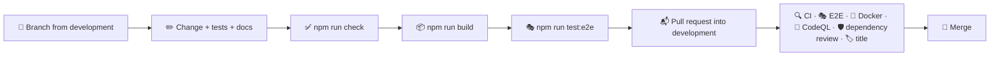

# 🤝 Contributing

## 🔄 Workflow



1. 🌿 Create a branch from `development`, named after the change: `feat/budget-rollover`, `fix/import-duplicates`.
2. ✅ Make your changes, add tests and run `npm run check` (and `npm run build` when routes, server code or configuration changed). For changes a person can see, also run `npm run test:e2e`.
3. 📝 Describe a user-visible change in one line under **Unreleased** in `CHANGELOG.md`.
4. 📬 Open a pull request into `development` and fill in the checklist from the template.
5. 🔀 Merge once everything is green. `development` reaches `staging` and `main` through the release flow in [Releases](./releases.md).

> [!TIP]
> `make setup` turns on the Git hooks in `.githooks/` (or run `git config core.hooksPath .githooks`). Before every commit they check the formatting and lint the staged files and look for em and en dashes; the message hook rejects messages that do not follow [Conventional Commits](#-commit-messages).

Bugs and ideas go through the issue forms in `.github/ISSUE_TEMPLATE`; security problems are reported privately as described in the [security policy](../.github/SECURITY.md).

> [!IMPORTANT]
> Keep `docs/` in sync with the code: a change to behaviour, a route, a column, an environment variable or a script belongs in the same pull request as its documentation.

## 🧹 Code style

Formatting and linting are automated, so reviews can focus on behaviour.

- 🎨 **Oxfmt** formats TypeScript, SCSS, JSON, YAML and Markdown with a print width of 120 and sorts imports into groups. Run `npm run format`.
- 🧹 **Oxlint** enables the `correctness`, `suspicious` and `perf` categories with type-aware TypeScript rules, React hooks and React Compiler rules, the Next.js, `jsx-a11y`, `import`, `unicorn` and `vitest` plugins, plus the layer rules below. Run `npm run lint`.
- 🔷 **TypeScript** runs in strict mode with `noUncheckedIndexedAccess`, `verbatimModuleSyntax` and `erasableSyntaxOnly`.
- 🧾 **No em or en dashes** in code, docs or texts: `npm run lint:text`, part of `npm run check` and CI, points to each one. Use a comma, a colon or a hyphen instead.
- 🔗 **Shared files stay identical.** The Git hooks, the scripts in `scripts/` that all four apps use, the comment plugin and the editor and Dependabot settings are the same in tasks, weather, faceit-stats and finance; `make shared` compares them when the other apps are checked out next to this one, `make shared-sync` copies the files of the app you changed over the other three, and the weekly **Shared files** workflow checks out the other three repositories and runs the same comparison.

### 💬 Comments

Names, small functions and types carry the intent, and every function, component, hook and effect, and every block that is not obvious, gets one short line above it that says what it does:

```ts
// Whether a value names a card the dashboard knows
const isCard = (value: unknown): value is DashboardCardId => typeof value === "string" && KNOWN.has(value);
```

> [!IMPORTANT]
> A custom Oxlint plugin in `lint/comments.js` (`local/short-comments`) reports comments longer than one line or 80 characters, comments at the end of a line of code and every lint, type or coverage directive (`eslint-disable`, `@ts-expect-error`, `istanbul ignore` and the like). Its second rule, `local/require-comments`, reports every function declaration and every variable holding a function without a comment line right above it.

Styles, configuration, SQL, Dockerfiles and workflows follow the same convention: mixins, keyframes, media and container queries, theme blocks and tables carry a line too. Lists such as `.gitignore`, `.dockerignore` and the Oxlint overrides are split into groups, each with a one-line heading, and `tsconfig.json` groups its options the same way. Test helpers get a line like any other function. Anything that needs more than a line belongs in `docs/`.

### 🧭 Where code goes

| You are adding…                                      | Put it in                                                               |
| ---------------------------------------------------- | ----------------------------------------------------------------------- |
| A page                                               | `src/app/(app)/<route>/page.tsx`, or `(auth)` before sign-in            |
| An API endpoint                                      | `src/app/api/<route>/route.ts`                                          |
| A region every page shares: navigation, the shell    | `src/widgets/<Widget>/`                                                 |
| Maths, parsing or domain logic                       | `src/features/<feature>/model/`                                         |
| Server code: queries, outside services, sealing      | `src/features/<feature>/api/`                                           |
| A page, card or sheet that belongs to one feature    | `src/features/<feature>/ui/<Component>/`                                |
| A field of the account's data                        | `features/data/model/types.ts` and `normalize.ts`                       |
| A table or column                                    | `db/schema.sql`, written so it can run again                            |
| A helper or component that knows nothing about money | `src/shared/lib`, `src/shared/ui`, `src/shared/hooks`, `src/shared/api` |
| Design tokens and mixins                             | `src/shared/styles/`                                                    |

Imports only point downwards: `app → widgets → features → shared`. Features and widgets may take the store hooks from `@/app/hooks` and the store types from `@/app/store`, nothing else from the app layer; Oxlint reports any other direction.

> [!WARNING]
> The development database may hold real money. A test never talks to it: unit tests use the fakes in `src/test/db.ts`, the end-to-end tests their own throwaway Postgres, see [Testing](./testing.md#-end-to-end-tests).

### 📐 Conventions

| Topic               | Convention                                                                                                                 |
| ------------------- | -------------------------------------------------------------------------------------------------------------------------- |
| 🧩 Components       | One folder per component: `Name/Name.tsx` and `Name.module.scss`, arrow functions, default export                          |
| 🖥️ Server or client | Pages are client components that read the store; route handlers and `api/` modules run on the server                       |
| 🔒 Secrets          | Anything that touches the database, a key or a token imports `server-only`                                                 |
| 🧮 Money            | Amounts stay in their own currency; convert with `convert()` from `shared/lib/money.ts` only to add them up or show them   |
| 📅 Dates            | Days as `YYYY-MM-DD` and months as `YYYY-MM` strings; helpers in `shared/lib/date.ts`                                      |
| 🧠 Derived numbers  | Pure functions of `AppState` in a `model/` folder; a page never fetches a number of its own                                |
| ✏️ Changes          | Through `update()` from `useStore()`, with an undo label when a person did it                                              |
| 🌍 Texts            | Never hard-code UI text. Add a key to every file in `shared/i18n/messages/` and use `t()`                                  |
| 🎨 Styles           | Tokens from `_tokens.scss`, the mixins in `_mixins.scss`, `_lists.scss` and `_motion.scss`, logical properties             |
| 🛡️ CSP              | No inline scripts; a `style` prop only for a width or a colour that comes from the data                                    |
| 🏷️ State attributes | Style states through ARIA attributes (`aria-current`, `aria-pressed`, `aria-selected`) or `data-active`, not extra classes |
| 📥 Imports          | The `@/` alias for every module outside the component's own folder                                                         |
| 🧪 Tests            | Next to the code as `*.test.ts(x)`; query by role and accessible name; type every mock                                     |

### 🃏 Adding a dashboard card

```tsx
"use client";

import { useMonthSummary } from "@/features/dashboard/model/useMonthSummary";
import { useI18n } from "@/shared/i18n/useI18n";
import Card from "@/shared/ui/Card/Card";
import Money from "@/shared/ui/Money/Money";

// What this month cost so far, in the base currency
const MonthCostCard = () => {
  const { current, base } = useMonthSummary();
  const { t } = useI18n();
  return (
    <Card title={t("dash.monthCost")} icon="wallet">
      <Money amount={current.expense} currency={base} />
    </Card>
  );
};

export default MonthCostCard;
```

Give the card an id in `DashboardCardId` (`features/data/model/types.ts`), put it in a column of `DEFAULT_DASHBOARD` and `CARD_TITLES` in `features/dashboard/model/layout.ts`, and map the id to the component in `DashboardPage`. Saved layouts pick the new card up in its default column. Add the messages in all ten languages.

> [!TIP]
> Give a card that holds a row of values a container query instead of a page breakpoint: the same card is wide in the main column and narrow in the side one.

## 📸 README pictures

`scripts/screenshots.mjs` takes every picture in `docs/images` from a running production build: it signs a new, empty account in and answers `/api/state` with the six months of data of the visual tests (`e2e/visual-state.ts`), with the clock at 15 September 2026, 10:00 Kyiv time. `make screenshots` builds the app, starts it on a throwaway database and runs the script, so no real account ever appears in a picture:

```bash
make screenshots                              # or another port: make screenshots PORT=3200
```

> [!WARNING]
> Never point the script at a server with real data: it creates an account there. `make screenshots` keeps it on the throwaway database.

## 📝 Commit messages

Commits follow [Conventional Commits](https://www.conventionalcommits.org/):

```text
feat(import): pair transfers between two own cards
fix(budgets): carry the rollover into January
style: soften the glass on the sheets
ci: verify npm registry signatures
docs: describe changing the encryption key
chore(deps): update next to 16.4
```

| Type          | Use it for                                      |
| ------------- | ----------------------------------------------- |
| ✨ `feat`     | A new feature                                   |
| 🐛 `fix`      | A bug fix                                       |
| ♻️ `refactor` | Code changes without new behaviour              |
| 💄 `style`    | Visual and styling changes                      |
| ✅ `test`     | Adding or updating tests                        |
| 📝 `docs`     | Documentation                                   |
| 👷 `ci`       | Pipeline and automation                         |
| ⚡ `perf`     | A faster or lighter app without new behaviour   |
| 📦 `build`    | The build, Docker images and build dependencies |
| 🔧 `chore`    | Dependencies and maintenance                    |
| ⏪ `revert`   | Reverting an earlier commit                     |

The `commit-msg` hook checks every message, and `.github/workflows/pr-title.yml` checks the title of every pull request, because a squash merge turns the title into the commit message.
