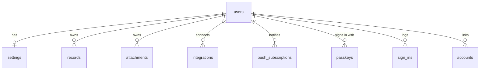

# 🗃️ Data model

## 📦 `AppState`

One object holds everything. It is what `/api/state` returns, what the store keeps in memory and what a JSON backup contains.

```ts
interface AppState {
  version: number;
  transactions: Transaction[]; // income, expense, transfer
  categories: Category[]; // two levels: parents and children
  recurring: RecurringRule[]; // auto-posted entries, weekly to yearly
  subscriptions: Subscription[]; // services billed weekly to yearly
  savings: SavingsAccount[]; // cards, cash, wallets, cryptocurrency, game items
  investments: Investment[]; // deposits, bonds, funds, stocks, cryptocurrency
  budgets: Budget[]; // monthly or yearly limit per category
  debts: Debt[]; // loans, mortgages, card debt
  receivables: Receivable[]; // money you lent and expect back
  rules: CategoryRule[]; // "description contains … → category or name", for imports
  wishlist: WishItem[]; // things to buy, with a price and a priority
  plannedEvents: PlannedEvent[]; // one-off amounts the forecast adds in a given month
  snapshots: NetWorthSnapshot[]; // one per day: net worth and its parts, in UAH
  goals: Goal[]; // savings goals of their own, beside the accounts' goals
  settings: Settings; // base currency, locale, theme, rates, tax profile, paid taxes, bank links
}
```

### 🔎 Entities worth knowing

| Entity             | Key fields                                                                                                                                                                                                | Notes                                                                                                                                                                                                                                                                                                                                                                                                                                                                                                                                                                                                                                                                                                                                                                                                                                            |
| ------------------ | --------------------------------------------------------------------------------------------------------------------------------------------------------------------------------------------------------- | ------------------------------------------------------------------------------------------------------------------------------------------------------------------------------------------------------------------------------------------------------------------------------------------------------------------------------------------------------------------------------------------------------------------------------------------------------------------------------------------------------------------------------------------------------------------------------------------------------------------------------------------------------------------------------------------------------------------------------------------------------------------------------------------------------------------------------------------------ |
| `Transaction`      | `type`, `amount`, `currency`, `categoryId`, `date`, `accountId`, `toAccountId`, `tax`, `breakdown`, `tags?`, `splitId?`, `attachmentIds?`, `externalId?`, `bank?`, `excluded?`, `unreviewed?`, `receipt?` | Transfers carry `toAmount` for cross-currency moves; `amount` on a taxed income is the **net** amount, with the gross kept in `tax.gross`. The pieces of a split purchase share a `splitId`; imported entries keep the bank's id in `externalId` and the operation's exact time and original amount in `bank`, and a transfer paired from two operations the other one's id in `bank.pairedId`. A tax marked paid can be booked as an expense with the id `tax:<obligation>`. An entry with `excluded` still moves its account's balance but counts towards no income, spending, budget or report (`counts()` in `features/data/model/finmath.ts`). `unreviewed` marks an imported entry nobody has looked at yet, `bank.text` the bank's own words of a renamed one, and `receipt` the register and receipt numbers of a scanned fiscal receipt |
| `Category`         | `kind`, `parentId?`, `icon`, `colorSlot`                                                                                                                                                                  | One level of nesting; charts roll children into parents                                                                                                                                                                                                                                                                                                                                                                                                                                                                                                                                                                                                                                                                                                                                                                                          |
| `SavingsAccount`   | `kind`, `currency`, `openingBalance`, `holdings?`, `goal?`, `bank?`, `game?`, `archived?`, `credit?`                                                                                                      | Balance = opening balance + ledger + coin holdings, entries in another currency converted at their month's rates; a card's `credit.limit` turns on the grace period reminder                                                                                                                                                                                                                                                                                                                                                                                                                                                                                                                                                                                                                                                                     |
| `Investment`       | `kind`, `principal`, `annualRatePct`, `marketValue?`, `quantity?`, `fund?`, `compounding`                                                                                                                 | Valuation depends on the kind, see [Investments](./investments.md)                                                                                                                                                                                                                                                                                                                                                                                                                                                                                                                                                                                                                                                                                                                                                                               |
| `Subscription`     | `price`, `period`, `dayOfMonth`, `startMonth`, `endMonth?`, `active`, `skipped?`                                                                                                                          | A subscription lives between two months and books weekly, monthly, quarterly or yearly; `skipped` lists the months (or weekly days) it no longer books, as does a `RecurringRule`, which also takes `period?` and an `instalment?` of a total and a count; see [Budgets and schedules](./budgets-and-schedules.md)                                                                                                                                                                                                                                                                                                                                                                                                                                                                                                                               |
| `Budget`           | `categoryId`, `limit`, `currency`, `rollover?`, `period?`, `moved?`                                                                                                                                       | With `rollover`, last month's unspent amount is added to this month's limit: one month's worth, never more; `moved` holds the amounts moved in or out, by month                                                                                                                                                                                                                                                                                                                                                                                                                                                                                                                                                                                                                                                                                  |
| `Receivable`       | `name`, `amount`, `currency`, `date`, `dueDate?`, `repaid`, `entryId?`                                                                                                                                    | Counts towards net worth until repaid in full; `entryId` names the expense someone's part of was paid for                                                                                                                                                                                                                                                                                                                                                                                                                                                                                                                                                                                                                                                                                                                                        |
| `NetWorthSnapshot` | `date`, `total`, `savings`, `investments`, `debts`, `receivables`, `rates`                                                                                                                                | Written quietly once a day (and again when the total moves), so the history shows what you really had, not a recomputation                                                                                                                                                                                                                                                                                                                                                                                                                                                                                                                                                                                                                                                                                                                       |
| `Settings`         | `baseCurrency`, `locale`, `theme`, `rates`, `ratesMeta`, `tax`, `taxPaid?`, `bankLinks?`, `dashboard?`, `monthRates?`, `notify?`, `ledgerViews?`, `calendar?`                                             | `tax` remembers the regime last used when adding income; `taxPaid` marks tax-calendar items as paid; `bankLinks` maps Monobank cards to accounts; `dashboard` holds the overview's card order per column and the hidden cards, and is left out while it matches the default (`features/dashboard/model/layout.ts`); `monthRates` holds each ended month's average NBU rates; `notify` turns off the instant notes; `ledgerViews` keeps the saved views; `calendar` says whether the calendar link is on and which link number it is                                                                                                                                                                                                                                                                                                              |

## 🧱 Database schema

`db/schema.sql` is the single source of truth and is **idempotent**: every table is `CREATE TABLE IF NOT EXISTS`, so running it twice changes nothing. The server applies it when it boots and again before the first query if the database was not up yet (`ensureSchema` in `src/shared/api/db.ts`), under an advisory lock so two booting servers never race; a fresh database needs no migration step. See [Deployment](./deployment.md#-schema-changes) for changing it.

Every value a person enters is sealed: the database holds the shape of the data, never its content.



| Table                                        | Key                           | Holds                                                                                                                                                                                                                                       |
| -------------------------------------------- | ----------------------------- | ------------------------------------------------------------------------------------------------------------------------------------------------------------------------------------------------------------------------------------------- |
| `records`                                    | `user_id`, `collection`, `id` | Every item of `AppState` but the settings, one sealed row each: `collection` is `transactions`, `categories`, `budgets` and so on, `id` is the item's key (a budget's category, a snapshot's date)                                          |
| `settings`                                   | `user_id`                     | The sealed settings, the plain `locale` the server writes notifications in, and `updated_at`, the revision every save checks and locks                                                                                                      |
| `attachments`                                | `user_id`, `id`               | Receipt photos, sealed, with their type; photos no entry refers to are removed a day after the save that dropped them                                                                                                                       |
| `integrations`                               | `user_id`, `provider`         | One row per connected bank (`monobank`): the sealed token, card list and webhook key, and a SHA-256 of that key in `webhook_hash` to find the row by                                                                                        |
| `push_subscriptions`                         | `user_id`, `id`               | One sealed row per device that gets notifications: its push address and keys                                                                                                                                                                |
| `passkeys`                                   | `id`                          | One row per passkey, keyed by the credential id, with the public key, counter, name and dates sealed                                                                                                                                        |
| `sign_ins`                                   | `id`                          | The method, device and address of each sign-in, sealed; the latest 50 per account are kept                                                                                                                                                  |
| `users`                                      | `id`                          | Email, password hash, the sealed profile (`profile_secret`) and two-step verification (`two_factor`), `session_epoch` with `epoch_keeper` (the one sign-in that outlives a rise, such as the one that set a new password) and `reminded_on` |
| `accounts`, `sessions`, `verification_token` |                               | The tables of the Auth.js adapter; only `accounts` is used, for Google sign-in                                                                                                                                                              |
| `app_errors`                                 | `id`                          | The latest 200 server failures (time, route pattern and message) for **Settings → Server problems**, which only the `OWNER_EMAIL` account sees                                                                                              |

Every table that belongs to an account refers to `users` with `ON DELETE CASCADE`, so deleting a user removes everything of theirs. The adapter writes the `name` and `image` of a Google account into `users` in the clear; the profile page seals them on its first save and clears the plain copy.

> [!NOTE]
> One `records` table instead of a table per collection: the server never queries inside a sealed record, so separate tables would only repeat the same three columns. A new collection in `AppState` needs no schema change at all, only its name in `COLLECTION_NAMES` and its key in `KEYS` in `features/data/model/changes.ts`.

## 🧼 Normalization is the gate

`normalizeState(raw)` in `features/data/model/normalize.ts` is called:

- when the server loads rows (`features/data/api/repo.ts`),
- when the server merges a save (`PATCH /api/state`),
- when the client receives state,
- when a JSON backup is imported.

It drops unknown fields, clamps numbers, validates enums and URLs, and brings older shapes up to date (old category names, tax profiles, return types per investment kind), so a JSON backup of an earlier version reads in cleanly. It never deletes entries the account holds: a record it cannot read is hidden, not removed from the table.

> [!TIP]
> Anything that must survive a round trip has to be handled in `normalizeState`. If a new field is not listed there, it will silently disappear on the next save.

## 💾 Backups

| Kind                 | How                                                                                        | Where                                   |
| -------------------- | ------------------------------------------------------------------------------------------ | --------------------------------------- |
| JSON (one account)   | Settings → Data → Download                                                                 | Browser download, restorable via Import |
| SQL (everything)     | `make backup ENV=development`, `staging` or `production`                                   | `backups/<env>-<timestamp>.sql`         |
| Nightly (production) | The `backup` service, checked and kept 14 days, see [Deployment](./deployment.md#-backups) | `backups/auto/prod-<timestamp>.dump`    |

Restore with `make restore ENV=development FILE=backups/development-….sql`; a `.dump` file works the same way.

> [!CAUTION]
> Take a SQL dump before every update on real data. Import in the app **replaces** all current data of the account: it is not a merge.
