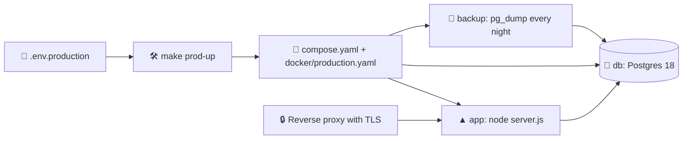

# 🚀 Deployment

Finance is self-hosted: one server runs the app and its Postgres database in Docker, behind a reverse proxy that terminates TLS. There is no public instance and no domain of its own; the address comes from `AUTH_URL`.

## 🧱 Three environments, one Makefile

`compose.yaml` holds what every environment shares: the `db` service with Postgres 18 and the `app` service built from `docker/Dockerfile`. One overlay per environment adds the rest:

| Environment    | Overlay                   | Env file          | App port | Database volume               | What it is                                                        |
| -------------- | ------------------------- | ----------------- | -------- | ----------------------------- | ----------------------------------------------------------------- |
| 🛠️ Development | `docker/development.yaml` | `.env`            | 3000     | `finance-development_db-data` | The dev server with hot reload; Postgres on `127.0.0.1:5432`      |
| 🧪 Staging     | `docker/staging.yaml`     | `.env.staging`    | 3001     | `finance-staging_db-data`     | The production build on a database of its own, to try a release   |
| 🚀 Production  | `docker/production.yaml`  | `.env.production` | 3000     | `finance-production_db-data`  | The production build with resource limits and the nightly backups |

Each environment keeps its database in a volume named after its Compose project, so the three never share data.

> [!NOTE]
> Versions before 1.0.0 kept their data in `finance-dev_db-data`, `finance-stage_db-data` and `finance-prod_db-data`, with another schema that this version does not read. To bring the data over, download a JSON backup in **Settings → Data** of the old app and read it in on the new one. The old volumes stay untouched until you remove them with `docker volume rm`.



Every environment has the same commands:

| What                       | Development        | Staging              | Production          |
| -------------------------- | ------------------ | -------------------- | ------------------- |
| Start                      | `make dev-up`      | `make stage-up`      | `make prod-up`      |
| Stop, keeping the database | `make dev-down`    | `make stage-down`    | `make prod-down`    |
| Rebuild and restart        | `make dev-restart` | `make stage-restart` | `make prod-restart` |
| Follow the logs            | `make dev-logs`    | `make stage-logs`    | `make prod-logs`    |
| State and health           | `make dev-ps`      | `make stage-ps`      | `make prod-ps`      |
| Shell in the app container | `make dev-shell`   | `make stage-shell`   | `make prod-shell`   |
| psql in the database       | `make dev-psql`    | `make stage-psql`    | `make prod-psql`    |
| Open in the browser        | `make dev-open`    | `make stage-open`    | `make prod-open`    |
| Remove containers and data | `make dev-clean`   | `make stage-clean`   | `make prod-clean`   |

`make backup ENV=…` and `make restore ENV=… FILE=…` dump and restore any environment, `make config ENV=…` prints the merged Compose file and `make status` shows which environments run. Production asks before every change; `YES=1` answers for scripts, and `make prod-clean` asks a second time because it deletes the database.

> [!IMPORTANT]
> Always start the stacks through `make`. It passes the env file of the environment to Compose with `--env-file`, so the database password in `POSTGRES_PASSWORD` reaches both the database and the `DATABASE_URL` of the app. A bare `docker compose up` would use the defaults instead.

## 🔐 Settings

`make env ENV=production` creates `.env.production` from `.env.example` with a fresh `AUTH_SECRET`, `DATA_ENCRYPTION_KEY` and database password. The settings are read when the container starts, never during the build, so one image serves every environment.

| Variable                       | Needed         | Meaning                                                                                                          |
| ------------------------------ | -------------- | ---------------------------------------------------------------------------------------------------------------- |
| `AUTH_URL`                     | ✅             | The public address of the app, exactly as the browser shows it; passkeys and sign-in links depend on it          |
| `AUTH_SECRET`                  | ✅             | Signs the sessions, `openssl rand -base64 32`                                                                    |
| `DATA_ENCRYPTION_KEY`          | ✅             | Seals every record, `openssl rand -base64 32`; losing it loses the data                                          |
| `POSTGRES_PASSWORD`            | ✅             | The password of the Docker database                                                                              |
| `OWNER_EMAIL`                  | Optional       | The only email that may sign up, and the one that sees the server errors in Settings                             |
| `REGISTRATION`                 | Optional       | `open` or `closed`; without `OWNER_EMAIL`, sign-up is closed on staging and production unless it says `open`     |
| `TRUSTED_PROXY_HOPS`           | Optional       | How many proxies stand in front of the app, 1 by default, see [Behind a reverse proxy](#-behind-a-reverse-proxy) |
| `APP_HOST`, `APP_PORT`         | Optional       | Where Docker publishes the app on the host, `127.0.0.1` and 3000 (3001 for staging) by default                   |
| `DATA_ENCRYPTION_KEY_PREVIOUS` | Optional       | The key before the last change, while records move to the new one                                                |
| `AUTH_GOOGLE_ID`, `…_SECRET`   | Optional       | Google sign-in                                                                                                   |
| `DATABASE_URL`                 | Outside Docker | Postgres for `npm run start` or `make dev`; Docker builds it from the `POSTGRES_` settings                       |
| `TZ`, `REMINDER_HOUR`          | Optional       | When the morning push note goes out, 9:00 in Kyiv by default; `REMINDERS=off` stops the clock                    |
| `BACKUP_…`                     | Optional       | The nightly backups, see [Backups](#-backups)                                                                    |

> [!CAUTION]
> Never reuse the development `POSTGRES_PASSWORD` or `AUTH_SECRET` in production, and never commit a real env file: only `.env.example` belongs in the repository.

## 🐳 The image

`docker/Dockerfile` has one stage per job:

| Stage         | Used by                   | What it does                                                                                                                                                                                                |
| ------------- | ------------------------- | ----------------------------------------------------------------------------------------------------------------------------------------------------------------------------------------------------------- |
| `base`        | every stage               | Node.js 26 on Alpine, pinned by digest                                                                                                                                                                      |
| `deps`        | development and build     | `npm ci` with a cache mount, rebuilt only when the lockfile changes                                                                                                                                         |
| `development` | `docker/development.yaml` | The dev server with hot reload; edits sync in but test reports do not, and Turbopack keeps no disk cache there (`TURBOPACK_DISK_CACHE=off`), since a write cut off in the container broke every later start |
| `build`       | runtime                   | `npm run build`; it needs no settings, so no secret ever enters a layer                                                                                                                                     |
| `runtime`     | staging and production    | The standalone server, `public/`, the static files and `db/schema.sql`, as the unprivileged `node` user, with a health check on `/healthz?db=1` that also asks the database                                 |
| `backup`      | production's backups      | Postgres 18 with `rclone` and `age` built in, running `docker/backup.sh`; it gets only the `PG…`, `TZ` and `BACKUP_…` settings, never the app's keys                                                        |

The containers of staging and production drop every Linux capability, cannot gain privileges, have a process limit, memory and CPU limits and rotated logs. The app applies `db/schema.sql` when it starts and before the first query, so a new database needs nothing but the container.

Every release also publishes the runtime image to GitHub Packages as `ghcr.io/sacrificed666/finance` for amd64 and arm64, see [Releases](./releases.md#-automation).

## 🔥 Development in Docker

`make dev-up` builds the `development` stage and starts it with `docker compose up --watch`: edits sync into the container and Turbopack picks them up at once, while a change to `package-lock.json` rebuilds the image. The database is published on `127.0.0.1:${POSTGRES_PORT:-5432}` for `psql` and other tools on the same computer.

> [!TIP]
> No Docker at hand? `make dev-db` starts the dev server on a throwaway Postgres in memory (PGlite, the same database the end-to-end tests use). Nothing it holds survives a restart.

The service worker registers in production builds only, so a stored script never hides a change being worked on; notifications and the offline page need `make stage-up` or `make build && make start`.

## 🧬 Schema changes

There is no migration tool: `db/schema.sql` only creates what is missing, on every start.

1. A new collection of the account's data needs no change at all: its items go into `records`, see [Data model](./data-model.md#-database-schema).
2. A new table goes into the file as `CREATE TABLE IF NOT EXISTS` with a one-line comment. A new column of an existing table needs an `ALTER TABLE … ADD COLUMN IF NOT EXISTS` of its own, because `CREATE TABLE IF NOT EXISTS` passes over a table that is already there.
3. Restart the app; it applies the file before the first query.

> [!WARNING]
> Only ever add. A column the code no longer reads stays, so a backup of an older version still restores. Take a backup before every release: `make backup ENV=production`.

## 💾 Backups

Production backs itself up, and development does too with the same script (daily at `DEV_BACKUP_HOUR`, files named `dev-…`). The `backup` service in `docker/production.yaml` runs `docker/backup.sh`:

- every night at `BACKUP_HOUR` (in `TZ`, `Europe/Kyiv` by default) it writes a compressed `pg_dump` to `backups/auto/prod-YYYYmmdd-HHMMSS.dump`;
- it reads each dump back with `pg_restore --list` before keeping it, so a broken file is logged and dropped instead of replacing a good one;
- it deletes dumps older than `BACKUP_KEEP_DAYS` (14 by default);
- on start it takes one straight away when today has none, so a fresh deploy is covered at once;
- with `BACKUP_REMOTE` set it copies every dump off the server, encrypted when `BACKUP_AGE_RECIPIENT` is set, and prunes the copies there after `BACKUP_REMOTE_KEEP_DAYS`;
- once a week, on `BACKUP_RESTORE_CHECK_DAY` (`0` is Sunday), it restores that night's dump into a scratch database, counts the accounts and entries in it, logs the result and drops the database.

```bash
make backups                                          # list the nightly dumps
make backup-now                                       # one more, checked, next to the nightly ones
make backup-check                                     # one more, then restored into a scratch database
make backup ENV=production                            # a plain SQL dump: backups/production-YYYYmmdd-HHMMSS.sql
make restore ENV=production FILE=backups/auto/prod-….dump   # .dump or .sql, the target picks the tool
```

> [!IMPORTANT]
> A dump is the database as stored: every record inside is still sealed with `DATA_ENCRYPTION_KEY`. Without that key a backup restores rows nobody can read, so keep the key in a password manager, never next to the dumps.

`backups/` is ignored by Git. A backup on the same disk does not survive that disk, so send copies elsewhere.

### 📤 Copies off the server

| Variable                   | Meaning                                                                                                                                 |
| -------------------------- | --------------------------------------------------------------------------------------------------------------------------------------- |
| `BACKUP_REMOTE`            | Where [rclone](https://rclone.org) copies each dump: `offsite:finance` for a remote named in the config, or a path                      |
| `BACKUP_AGE_RECIPIENT`     | An [age](https://age-encryption.org) public key (`age1…`). With it the copy is `….dump.age`, and only the matching private key opens it |
| `BACKUP_REMOTE_KEEP_DAYS`  | How long copies stay there, 90 days by default                                                                                          |
| `BACKUP_RESTORE_CHECK_DAY` | The weekday of the restore check, `0` to `6` from Sunday                                                                                |

1. Describe the remote in `backups/rclone.conf` (`rclone config` on any computer writes one: S3, Backblaze B2, Google Drive, another server over SFTP). The backup service reads it from there, so no storage credentials travel through the env file.
2. Run `age-keygen -o finance-backup.key` on a computer you trust, put the `age1…` line in `BACKUP_AGE_RECIPIENT` and keep the key file with `DATA_ENCRYPTION_KEY`, **not** on the server.
3. `make prod-up`, then `make backup-check`, and look for `copied …` and `restore check passed` in `make prod-logs`.

To use an encrypted copy: `age -d -i finance-backup.key -o prod.dump prod-….dump.age`, then `make restore ENV=production FILE=prod.dump`.

## 🔑 Changing the encryption key

Records move to a new key by themselves the first time each account loads after a restart, see [Security](./security.md#-encryption-at-rest).

| Situation                                                                        | What to put in the env file                                                         |
| -------------------------------------------------------------------------------- | ----------------------------------------------------------------------------------- |
| Records sealed with the key derived from `AUTH_SECRET`, no `DATA_ENCRYPTION_KEY` | A new `DATA_ENCRYPTION_KEY`; keep `AUTH_SECRET` until the move is done              |
| Replacing `DATA_ENCRYPTION_KEY`                                                  | The new key as `DATA_ENCRYPTION_KEY`, the old one as `DATA_ENCRYPTION_KEY_PREVIOUS` |

1. `make backup-now`: the dump is the way back.
2. Edit `.env.production`, then `make prod-restart`.
3. Open the app once and look for `Re-sealed records of one account with the current key` in `make prod-logs`.
4. Then `DATA_ENCRYPTION_KEY_PREVIOUS` can go, and `AUTH_SECRET` may change again.

> [!NOTE]
> The push notification key is derived from the same secret, so after a change of key each device has to switch notifications on again in Settings.

## 🔄 Workflows

| Workflow         | When                          | What it does                                                                                                                                                                                                           |
| ---------------- | ----------------------------- | ---------------------------------------------------------------------------------------------------------------------------------------------------------------------------------------------------------------------- |
| 🚀 `ci`          | Every push and pull request   | Signatures, the changelog, lint, the dash check, formatting, types, unit tests with coverage, the build report, end-to-end tests in Chromium with Lighthouse and in WebKit, the Docker image and every Compose overlay |
| 🛡️ `codeql`      | Every change and on Mondays   | CodeQL security queries for the code and the workflows                                                                                                                                                                 |
| 🏷️ `pr-title`    | Every pull request            | The title follows Conventional Commits                                                                                                                                                                                 |
| 🏷️ `release`     | Every `v*.*.*` tag            | The GitHub release with its changelog notes and the multi-platform image, see [Releases](./releases.md)                                                                                                                |
| 📸 `screenshots` | By hand after a design change | Takes the screenshots of the visual tests on Linux and uploads them                                                                                                                                                    |
| 📡 `monitor`     | Hourly and on Mondays         | Once the repository variable `MONITOR_URL` points at a running server: the health check, the sign-in page, `security.txt` and `robots.txt` every hour, and Lighthouse every week                                       |
| 🔗 `shared`      | Mondays and by hand           | Checks out tasks, weather and faceit-stats and compares the files the four apps share                                                                                                                                  |

## 🩺 Health and troubleshooting

| Symptom                                       | Where to look                                                                                                        |
| --------------------------------------------- | -------------------------------------------------------------------------------------------------------------------- |
| Every device asked to sign in again           | `AUTH_SECRET` changed, or **Sign out everywhere** was used on the profile page                                       |
| Sign-in keeps asking for a code that is right | The phone's clock is off by more than 30 seconds; turn on automatic time                                             |
| Phone and recovery codes both lost            | A passkey still signs in; otherwise turn two-step verification off from the database, below                          |
| Creating or using a passkey fails at once     | `AUTH_URL` has to be the exact address in the browser's bar: the same scheme, host and port                          |
| No morning notification                       | Nothing was due, the device's switch is off, or the browser blocks the site; **Send a test** in Settings tells which |
| Notifications stopped after a secret changed  | The push key follows `DATA_ENCRYPTION_KEY` (or `AUTH_SECRET`); switch notifications on again on each device          |
| Blank exchange rates                          | Monobank allows one rate request every five minutes; the NBU fallback covers it                                      |
| Cryptocurrency prices missing                 | CoinGecko throttling; the previous prices stay and the error is shown next to them                                   |
| Logos redirect to `/login`                    | A public folder missing from the matcher in `src/proxy.ts`                                                           |
| Monobank import waits a minute per card       | Monobank allows one statement request a minute; the card counts down and continues                                   |
| Installed app shows an old version            | The service worker is fetched with `no-store`; closing every window of the app picks up the new one                  |

Failures are also kept in the database, so they can be read without a shell: **Settings → Server problems** lists the latest ones to the owner (`OWNER_EMAIL`) and appears only when there are any. Every API handler that catches an error records it (`logError` in `src/features/settings/api/errorLog.ts`), and `onRequestError` in `src/instrumentation.ts` records the ones nothing caught, by route pattern such as `POST /api/monobank/webhook/[key]`, so no secret from an address ends up in the log. A page that fails in a signed-in browser is reported as well, as `browser /reports` with the error's message, by its path and never its query. The table keeps the latest 200; **Clear** empties it.

### 🔓 Locked out of two-step verification

Only the owner of the server can do this, and it needs nothing but database access. Open `psql` with `make prod-psql` and clear the column of the account:

```sql
UPDATE users SET two_factor = NULL WHERE lower(email) = 'you@example.com';
```

Sign in with the password alone, then set two-step verification up again on the profile page.

## 🔒 Behind a reverse proxy

- Terminate TLS in the proxy (Caddy, nginx, Traefik) and forward to the app port; set `AUTH_URL` to the public `https://` address.
- 🔌 Staging and production publish the app on `127.0.0.1` only (`APP_HOST`), so the proxy on the same server reaches it and nothing else does. A proxy on another machine needs `APP_HOST=0.0.0.0` and a firewall that lets only the proxy in.
- 🧭 Rate limits and the recent sign-ins use the address the proxy added: the last entry of `X-Forwarded-For`, which a visitor cannot write. With more than one proxy in a row (a CDN in front of Caddy, say), set `TRUSTED_PROXY_HOPS` to how many there are.
- Postgres is published only in development, and only on `127.0.0.1`.
- Automatic Monobank import needs `AUTH_URL` on `https://`, so Monobank can reach the webhook.
