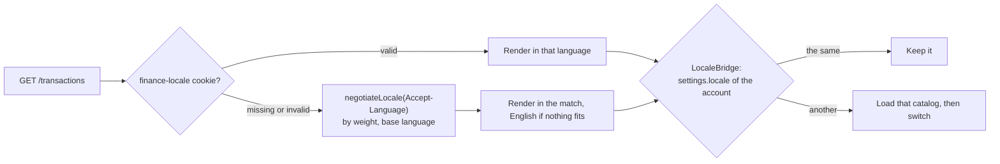
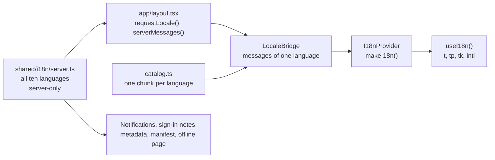

# 🌍 Localization

The interface speaks ten languages: 🇬🇧 English, 🇺🇦 Ukrainian, 🇨🇿 Czech, 🇩🇪 German, 🇪🇸 Spanish, 🇫🇷 French, 🇮🇹 Italian, 🇳🇱 Dutch, 🇵🇱 Polish and 🇵🇹 Portuguese. Money, numbers, dates, month and weekday names, plurals, exported spreadsheets, the morning notification and the offline page follow the chosen language too.

## 🧭 How the language is chosen

The app is private, so its addresses carry no language: the language belongs to the account and moves with it across devices.



1. 🗄️ `settings.locale` from the account, once the data has loaded (`app/LocaleBridge.tsx`).
2. 🍪 The `finance-locale` cookie, read by the server on the first render, so the sign-in page and the shell already greet a person in their language.
3. 🌐 `Accept-Language`: `negotiateLocale()` in `shared/i18n/locales.ts` sorts the browser's languages by their `q` weight, reduces tags to the base language (`uk-UA` → `uk`) and takes the first supported one.
4. 🇬🇧 English.

Picking a language in **Settings → General** saves it with the account and writes the cookie, so the next visit on any device starts in it. The picker on the sign-in page, before there is an account, writes the cookie alone.

## 📚 Messages

Messages are flat objects in `shared/i18n/messages/`, one file per language, about 1,750 keys each:

```ts
export const en = {
  "common.categories.one": "{count} category",
  "common.categories.other": "{count} categories",
  "tax.limit.of": "of {limit}",
} as const;

export type MessageKey = keyof typeof en;
export type Dictionary = { [K in MessageKey]: string } & Record<string, string>;
```

- 🇬🇧 `en.ts` defines the keys. Every other file is typed as `Dictionary`, so a missing key fails the type check.
- ✅ `messages.test.ts` checks that every language has every English key and, beyond them, only plural forms; that it keeps every placeholder of the English text; that extra plural forms carry the placeholders of the other form; that a placeholder asks only for a known shape; and that no text is empty.
- 🔢 Plurals follow `Intl.PluralRules`: English, German, Spanish, French, Italian, Dutch and Portuguese need `.one` and `.other`; Czech also `.few`, Ukrainian and Polish `.few` and `.many`. A form a language does not have falls back to `.other`.
- 🇫🇷 French puts a no-break space before `:`, `;`, `!`, `?` and `»` and after `«`, so the sign never starts a line.
- 🗓️ A month inside a sentence comes as words in the language's own case (`formatMonthText`: "October 2026", "жовтень 2026 р.", "octubre de 2026"), and a text may shape it after a bar: `{month|gen}` puts its name in the genitive where the language has one (`з {month|gen}` reads "з жовтня 2026 р.", `od {month|gen}` "od října 2026"), from the forms `Intl.DateTimeFormat` gives a day; `{month|cap}` starts it with a capital. Slavic languages have no locative from `Intl`, so their texts say `за {month}` or use the genitive instead of "у жовтні".
- 🔤 Keys are grouped by area: `common`, `nav`, `dash`, `tx`, `balance`, `income`, `tax`, `taxcal`, `investments`, `forecast`, `reports`, `calendar`, `import`, `profile`, `ach`, `settings`, `auth`, `push`, `offline`, `export` and a few smaller ones.

## 🧰 Using translations

```tsx
const { t, tp, tk, has, locale, intl } = useI18n();

t("tx.flow"); // a plain message
t("tax.limit.left", { pct, left }); // {placeholders}
tp("profile.stats.weeksValue", weeks); // the plural form for a count, {count} filled in
tk(`ach.${id}.title`, id); // a key built at run time, with a fallback
categoryName(i18n, category); // built-in categories translated, renamed ones kept
```

`t()` shows the key itself for a moment while a catalog is still loading; unknown placeholders are left as they are.

## 🖥️ Server and client



- 🗄️ `server.ts` imports every language and is marked `server-only`, so the browser never downloads all ten.
- 📦 The root layout passes only the current language's messages to `LocaleBridge`, so the first render needs nothing more. The other nine are separate chunks behind `loadMessages()` in `catalog.ts`: switching language loads the new one, and the page keeps the old language until it has arrived. A load that fails keeps the current one.
- 🧠 `makeI18n()` in `translate.ts` has no React in it, so the server builds a translator in the account's language for the texts it writes itself: the morning notification, the note about a new sign-in, page titles, the manifest of the installed app and the offline page.

> [!TIP]
> Never import a catalog from client code. One static `import { uk } from "./messages/uk"` puts that language back into every page's bundle; the ten catalogs together weigh about 1 MB before compression.

## 🔢 Formatting

`I18nProvider` hands the language's formatting tag to `setFormatLocale()`, which `shared/lib/money.ts` and `shared/lib/date.ts` read: `Intl.NumberFormat` and `Intl.DateTimeFormat` then give month names, weekday names, decimal separators, currency signs and compact notation without any translated strings.

Each app language has a regional formatting locale in `LOCALE_INFO`: `en-GB`, `uk-UA`, `cs-CZ`, `de-DE`, `es-ES`, `fr-FR`, `it-IT`, `nl-NL`, `pl-PL` and `pt-PT`. English therefore uses a 24-hour clock and day-month dates, and Portuguese follows Portugal.

Exported CSVs follow the language as well (`csvStyle` in `features/reports/model/export.ts`): where the language writes a decimal comma, columns are separated by `;` and amounts use the comma, as a spreadsheet in that language expects; English gets `,` and a decimal point. Headers are translated, and a byte-order mark keeps Cyrillic readable in Excel. The income book is the exception: a Ukrainian tax record, it is always written the Ukrainian way.

## ➕ Adding a language

1. Add the code to `LOCALES` and its details to `LOCALE_INFO` in `shared/i18n/locales.ts`:

   ```ts
   sv: { name: "Svenska", english: "Swedish", intl: "sv-SE", flag: "SE" },
   ```

2. Copy `messages/en.ts` to `messages/sv.ts`, type it as `Dictionary` and translate every value. Keep the keys and the `{placeholders}`, and add the plural forms the language needs.
3. Register it in `LOADERS` in `catalog.ts`, in `MESSAGES` in `server.ts` and in the list in `messages/messages.test.ts`. Its flag is there already: `/flags/{code}` prerenders every country.
4. Run `npm run check` and look at the app with the new language selected, on a phone too: long words are the usual reason for a broken layout.

> [!TIP]
> Write for the interface, not for a dictionary: short labels, no full stops in buttons, sentence case for hints, and the same terms as the rest of the app. Never shorten product terms ("cryptocurrency", not slang): shortened jargon reads badly in most of the ten languages.

> [!IMPORTANT]
> Montserrat is loaded in the Latin, Latin Extended and Cyrillic subsets. A language with another script (Greek, Arabic, Hebrew…) needs its subset in `app/fonts.ts`, or it falls back to a system font.
