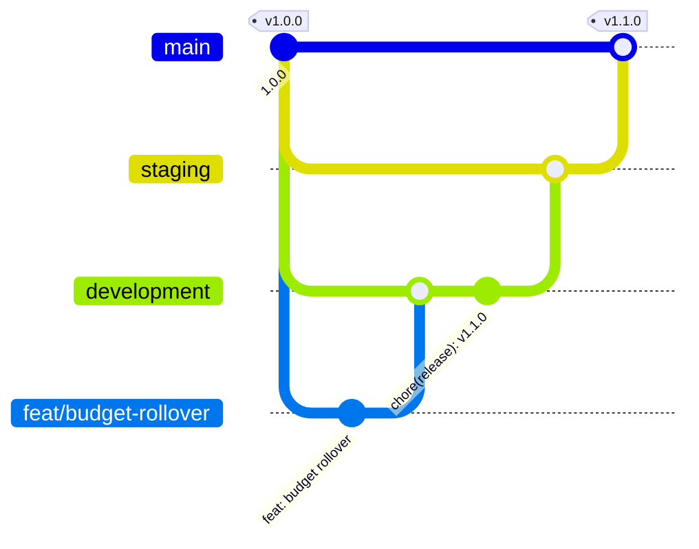

# 🏷️ Releases

Finance uses [Semantic Versioning](https://semver.org/spec/v2.0.0.html). The version lives in `package.json`, the footer of the app shows it with a link to the changelog, and every release is described in [CHANGELOG.md](../CHANGELOG.md) in the [Keep a Changelog](https://keepachangelog.com/en/1.1.0/) format. The current version is **1.0.0**.

## 🔢 Version numbers

| Part     | Changes when                                                                                                                                                                             | Example |
| -------- | ---------------------------------------------------------------------------------------------------------------------------------------------------------------------------------------- | ------- |
| 🔴 Major | Something people or servers rely on stops working: a removed feature, a backup an older version cannot read back, a schema change that needs a hand, a new required environment variable | `2.0.0` |
| 🟡 Minor | A new feature or a visible improvement that keeps everything else working, including new tables and columns the server adds on its own                                                   | `1.1.0` |
| 🟢 Patch | Bug fixes, security fixes, dependency updates and text corrections                                                                                                                       | `1.0.1` |

> [!TIP]
> The commit types point at the next version: a `feat` calls for a minor release, a `fix` for a patch, and a `!` after the type (`feat!: …`) or a `BREAKING CHANGE:` footer for a major one.

## 🌿 Branches



| Branch               | Purpose                                                          | Runs on                           |
| -------------------- | ---------------------------------------------------------------- | --------------------------------- |
| 🌱 `development`     | Finished work comes together here; every pull request targets it | 🛠️ `make dev-up` on your computer |
| 🧪 `staging`         | The next release, checked as a whole before it reaches the data  | 🔍 `make stage-up` on the server  |
| 🚀 `main`            | Released code only; every merge into it is tagged with a version | 🌍 `make prod-up` on the server   |
| 🌿 `feat/…`, `fix/…` | One change, branched from `development`                          | 🎭 CI with a throwaway database   |

## 🚀 Cutting a release

1. 🔢 On `development`, pick the version from the notes under **Unreleased** and bump it without a tag:

   ```bash
   npm version minor --no-git-tag-version
   ```

2. 📝 In `CHANGELOG.md`, rename **Unreleased** to `## [1.1.0] - YYYY-MM-DD`, add an empty **Unreleased** section above it and update the comparison links at the bottom.
3. 📬 Commit as `chore(release): v1.1.0` and open a pull request from `development` into `staging`. Start it with `make stage-up`, restore a recent production backup into it with `make restore ENV=staging FILE=…` and check it in a few languages, on a phone and in both themes.
4. 🔀 Open a pull request from `staging` into `main` and merge it.
5. 🏷️ Tag the merge on `main` and push the tag:

   ```bash
   git switch main && git pull
   git tag -a v1.1.0 -m "v1.1.0"
   git push origin v1.1.0
   ```

6. 🤖 The release workflow publishes the GitHub release with the notes of that version from `CHANGELOG.md` and the Docker image.
7. 🌍 On the server, `git pull` on `main` and run `make prod-up`. The schema follows on its own, see [Deployment](./deployment.md#-schema-changes).

> [!IMPORTANT]
> The tag must equal `v` plus the version in `package.json` and point at a commit on `main`. Otherwise the release workflow fails before anything is published.

> [!CAUTION]
> Take a backup with `make backup ENV=production` before every production update. A schema change runs once, on the first start of the new version.

## 🩹 Hotfixes

An urgent fix does not wait for `development`:

1. 🌿 Branch `fix/…` from `main`, fix the problem and bump the patch version (`npm version patch --no-git-tag-version`).
2. 📝 Add the `## [1.0.1] - YYYY-MM-DD` section to `CHANGELOG.md`.
3. 🔀 Merge the pull request into `main`, then tag and push `v1.0.1` as above.
4. ↩️ Merge `main` back into `staging` and `development`, so the fix is not lost in the next release.

## 🤖 Automation

| Where                                  | What it checks                                                                                                                                                                                                                                                                                                                                                                                                                                                   |
| -------------------------------------- | ---------------------------------------------------------------------------------------------------------------------------------------------------------------------------------------------------------------------------------------------------------------------------------------------------------------------------------------------------------------------------------------------------------------------------------------------------------------- |
| 🔍 CI on every push and pull request   | `scripts/release-notes.mjs` finds a non-empty `CHANGELOG.md` section for the version in `package.json`                                                                                                                                                                                                                                                                                                                                                           |
| 🏷️ `release.yml` on every `v*.*.*` tag | The tag matches `package.json`, the commit is on `main`, then `gh release create` publishes the release with the notes of the version; then the `image` jobs build amd64 and arm64 natively on their own runners and the `manifest` job publishes `ghcr.io/sacrificed666/finance` for both, tagged `1.2.3`, `1.2` and `latest`, with provenance and an SBOM. Run the workflow by hand with a tag such as `v1.2.3` to build the image of a released version again |
| 🏷️ `pr-title.yml` on pull requests     | The title follows Conventional Commits, so a squash merge keeps the history readable                                                                                                                                                                                                                                                                                                                                                                             |
| 🤖 Dependabot every Monday             | Opens its pull requests against `development`, so updates ship with the next release                                                                                                                                                                                                                                                                                                                                                                             |

Run `node scripts/release-notes.mjs` locally to see the notes of the current version, or `node scripts/release-notes.mjs v1.1.0` to check a tag before pushing it.

> [!NOTE]
> The image is built without any settings or keys: `AUTH_URL`, the secrets and the database come from the env file when the container starts. One image serves staging and production alike.

## ⚙️ One-time GitHub setup

1. Create the `development` and `staging` branches from `main` and make `development` the default branch, so new pull requests target it.
2. Protect `main` and `staging` under **Settings → Rules**: require a pull request and the `verify`, `build`, `e2e` and `docker` checks, and block force pushes.
3. Optionally add a tag rule for `v*`, so only maintainers can create releases.
4. Optionally add the repository variable `MONITOR_URL` (the address in `AUTH_URL`) under **Settings → Secrets and variables → Actions**, so the monitor checks the running server every hour.
5. After the first release, decide under **Your profile → Packages** whether the image stays private or anyone may pull it.

## ☁️ Environments

Finance has no hosted deployment: every environment is a Docker Compose stack on a computer or a server of your own, started through `make`.

| Environment    | Branch        | Command         | Env file          | Database volume               |
| -------------- | ------------- | --------------- | ----------------- | ----------------------------- |
| 🌍 Production  | `main`        | `make prod-up`  | `.env.production` | `finance-production_db-data`  |
| 🔍 Staging     | `staging`     | `make stage-up` | `.env.staging`    | `finance-staging_db-data`     |
| 🧪 Development | `development` | `make dev-up`   | `.env`            | `finance-development_db-data` |

Each environment has its own database, keys and `AUTH_URL`; `APP_ENV` names it in the server logs. No environment is ever indexed: `robots.txt` blocks every crawler and every page is `noindex`, see [SEO](./seo.md). The whole setup is described in [Deployment](./deployment.md).
