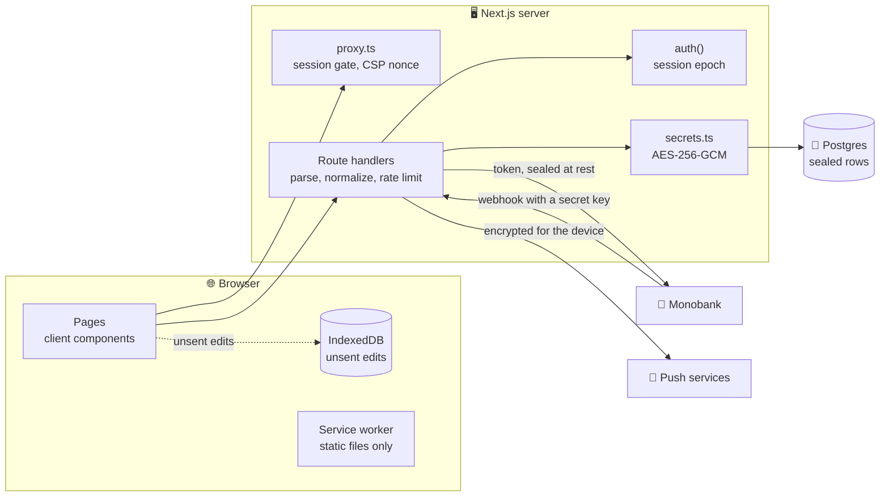

# 🛡️ Security

Finance keeps a person's money on a server of their own. Its valuable assets are the **records in the database**, the **keys in the env file** that sign the sessions and seal those records, and the **Monobank token** of an account. Its attack surface is what reaches the server: the sign-in, the API routes, the Monobank webhook and the data that comes back from outside services.

To report a vulnerability, follow the [security policy](../.github/SECURITY.md).

## 🗺️ Trust boundaries

## 👥 Accounts

Who may create an account follows `signUpAllowed` in `features/auth/model/authConfig.ts`: with `OWNER_EMAIL` set, only that address; otherwise `REGISTRATION=open` or `closed` decides, and without either, sign-up is open in development and closed on staging and production. `POST /api/auth/register` answers `403` to anyone else, and a first sign-in with Google follows the same rule (a Google account whose email already has an account may always sign in and is linked to it). Every row in the database carries its `user_id`, every query filters by the account of the session, and `e2e/security.spec.ts` checks that one account never sees a note of another. There are no roles and no sharing; only the account of `OWNER_EMAIL` reads the server errors in Settings.

> [!IMPORTANT]
> Set `OWNER_EMAIL` on any server other people can reach. Staging and production close sign-up without it, so the owner needs it to create the account at all; `REGISTRATION=open` opens it to everyone, who then see only their own empty account but use your server and its disk (each account keeps at most about half a gigabyte of receipt photos).

## 🔑 Sessions and passwords

| Concern               | Implementation                                                                                                                                                                                                                                                                                                                                                                                                        |
| --------------------- | --------------------------------------------------------------------------------------------------------------------------------------------------------------------------------------------------------------------------------------------------------------------------------------------------------------------------------------------------------------------------------------------------------------------- |
| Session               | Auth.js with the JWT strategy in an `HttpOnly` cookie, signed with `AUTH_SECRET`                                                                                                                                                                                                                                                                                                                                      |
| Credentials           | Email and password, checked against `users.password_hash`                                                                                                                                                                                                                                                                                                                                                             |
| Hashing               | `scrypt` with N = 2¹⁷, r = 8, p = 1, a random 16-byte salt and a 64-byte key, stored with its parameters; older hashes are upgraded on the next successful sign-in                                                                                                                                                                                                                                                    |
| Comparison            | `timingSafeEqual`, and a dummy hash when the email has no account, so the time taken does not tell whether it exists                                                                                                                                                                                                                                                                                                  |
| Minimum password      | 10 characters, checked on the server (`passwordProblem`); the strength meter on the page only advises                                                                                                                                                                                                                                                                                                                 |
| Rate limits           | Per 15 minutes: 10 sign-in attempts per email and address and 30 per email from anywhere, 20 passkey sign-ins and 30 passkey challenges per address, 5 sign-ups per address, 10 password changes, 10 two-step confirmations and 5 test notifications per account. The address is the one the proxy added to `X-Forwarded-For`, never one the visitor wrote, see [Deployment](./deployment.md#-behind-a-reverse-proxy) |
| Google sign-in        | Optional; appears, on the sign-in page and as **Link** on the profile, only when `AUTH_GOOGLE_ID` and `AUTH_GOOGLE_SECRET` are set; a verified Google email only                                                                                                                                                                                                                                                      |
| New password          | Signs out every other device: the epoch rises and only the session that changed the password carries on                                                                                                                                                                                                                                                                                                               |
| After sign-in         | The `next` page is followed only when it is a path of this app; control characters and backslashes, which browsers bend into another site, send you to the dashboard                                                                                                                                                                                                                                                  |
| Two-step verification | Optional TOTP (RFC 6238: SHA-1, six digits, 30-second steps, one step of clock drift either way) on top of the password                                                                                                                                                                                                                                                                                               |
| Recovery codes        | Eight single-use codes, shown once, stored as SHA-256 hashes and compared in constant time                                                                                                                                                                                                                                                                                                                            |
| Code replay           | Each code works once: the server remembers the last step an account signed in with                                                                                                                                                                                                                                                                                                                                    |
| Passkeys              | WebAuthn through `@simplewebauthn/server`: discoverable credentials, user verification required (a fingerprint, face or PIN on every use), no attestation asked for; the public key and counter are sealed in `passkeys`                                                                                                                                                                                              |
| Sign-in log           | The method, device and address of every sign-in, sealed in `sign_ins`; the latest 50 per account are kept                                                                                                                                                                                                                                                                                                             |

### 🔢 Two-step verification

Profile → Sign-in → **Two-step verification** shows a QR code and the same key as text for any authenticator app, and turns on only after the first code from that app is accepted. The recovery codes appear once, with buttons to copy or download them. From then on, signing in with email and password asks for the current code; a recovery code works in the same field and is used up.

| Rule                                                             | Why                                                                          |
| ---------------------------------------------------------------- | ---------------------------------------------------------------------------- |
| Turning it off needs a current code or a recovery code           | A session left open on someone else's computer cannot remove the second step |
| It cannot be set up again while it is on                         | Replacing the secret would need no proof of the old one; turn it off first   |
| Code attempts count towards the 10 sign-in attempts              | Six digits cannot be guessed inside the limit                                |
| The secret lives in `users.two_factor`, sealed like every record | A database dump does not reveal it                                           |

It covers email-and-password sign-in only. Google sign-in relies on the protection of the Google account itself.

> [!WARNING]
> Losing the phone and every recovery code locks the account behind the second step. Whoever runs the server can still turn it off in the database, see [Deployment](./deployment.md#-locked-out-of-two-step-verification).

### 🔐 Passkeys

Profile → Sign-in → **Passkeys** adds one for the device in hand: its fingerprint, face or screen lock, or a phone nearby. The sign-in page then offers **Sign in with a passkey**, which needs no email and no password.

| Rule                                                                                                    | Why                                                                                           |
| ------------------------------------------------------------------------------------------------------- | --------------------------------------------------------------------------------------------- |
| Registration and sign-in each get a one-time challenge that expires after five minutes and is used once | A recorded answer cannot be played back                                                       |
| The origin and the relying party come from `AUTH_URL`                                                   | A passkey made for this address works nowhere else, and a lookalike address cannot ask for it |
| The signature counter is kept and checked                                                               | A cloned authenticator gives itself away                                                      |
| A passkey sign-in skips the authenticator-app code                                                      | The passkey already proves both the device and the person holding it                          |
| The authenticator must verify the person each time                                                      | A security key without a PIN cannot stand in for the password and the code by itself          |

Removing a passkey on the Profile page stops it from signing in straight away; the copy on the device stays until it is removed there too.

### 🕵️ Recent sign-ins and signing out everywhere

**Recent sign-ins** on the Profile page lists the last ten: the browser and system, how (password, Google or passkey), the address and the time, with the current session marked. The first time a browser and system not seen in the last 180 days signs in, every device with notifications on gets a note: "Not you? Sign out everywhere from your profile." The very first sign-in of an account sends nothing.

**Sign out everywhere** ends every session of the account, the current one included. Sessions are signed cookies, so nothing is deleted: the server raises `users.session_epoch`, and each check of a session compares it with the epoch stored in the cookie. Every server process caches the epoch for 30 seconds. A session of an account that no longer exists ends the same way, so a stale cookie never writes for a missing user. A browser whose session has ended gets the sign-in form on its next request.

> [!WARNING]
> Changing `AUTH_SECRET` signs every session out. Keep it in the env file only, and keep the env files out of version control (they already are).

## 🔒 Encryption at rest

Every record is stored as an **AES-256-GCM** ciphertext, not as readable columns:

| Table                  | What is sealed                                                                                                              |
| ---------------------- | --------------------------------------------------------------------------------------------------------------------------- |
| `records`              | Every item of the account's data: entries, categories, accounts, investments, budgets, debts, goals, snapshots and the rest |
| `settings`             | Everything except the interface language                                                                                    |
| `users`                | Name, avatar, about, occupation, location, link and birthday; the two-step verification secret and recovery-code hashes     |
| `integrations`         | The Monobank token, card list and webhook key                                                                               |
| `push_subscriptions`   | The push address and keys of each device                                                                                    |
| `passkeys`, `sign_ins` | The public key and counter of each passkey; the method, device and address of each sign-in                                  |
| `attachments`          | The receipt photo itself                                                                                                    |

A sealed row keeps only its keys (`user_id`, the collection and `id` of a record) and a `secret` column with `enc.v2.` and the IV, tag and ciphertext in base64. A dump of the database shows how many entries, accounts or budgets there are, but not a single amount, name or note. The one plain copy is the `name` and `image` that Google sign-in writes into `users`, until the profile is first saved.

Every value is also bound to where it is kept: the place, such as `records/<user>/transactions/<id>` or `settings/<user>` (`sealedIn` in `shared/lib/secrets.ts`), goes into the cipher as additional authenticated data. Someone who can write to the database still cannot move a sealed value to another row or another account: it no longer opens there, and the load stops instead of reading it.

`app_errors` is not sealed: it holds error messages and route patterns, keeps only the latest 200, and only the owner can read it. No record is written into it, though a database error can quote the value it tripped on, an email address in a duplicate-key error for example.

| Variable                       | Meaning                                                                                                   |
| ------------------------------ | --------------------------------------------------------------------------------------------------------- |
| `DATA_ENCRYPTION_KEY`          | 32 random bytes in base64 (`openssl rand -base64 32`), the key that seals every record                    |
| `DATA_ENCRYPTION_KEY_PREVIOUS` | Optional: the key before the current one, while records move over after a change of key                   |
| `AUTH_SECRET`                  | A key is derived from it when `DATA_ENCRYPTION_KEY` is missing, so records are never written in the clear |

Records are always sealed with the current key. Reading tries the current key first, then `DATA_ENCRYPTION_KEY_PREVIOUS`, then the key derived from `AUTH_SECRET` (`shared/lib/sealing.ts` and `shared/lib/secrets.ts`). The first time an account loads its data after the server starts, every record of that account that only an older key opens is sealed again with the current one, for the same place, across all sealed tables listed in `features/data/api/reseal.ts`, in one transaction, and the server logs how many. That makes a change of key an edit to the env file and a restart, see [Deployment](./deployment.md#-changing-the-encryption-key).

> [!CAUTION]
> Losing the key means losing the data: there is no way back. Keep `DATA_ENCRYPTION_KEY` in a password manager, apart from the backups. A record sealed with a key the server does not have, or moved from another place, stops loading with "A record is sealed with a key this server does not have, or for another place".

## 🚦 Request authorisation

Every API route calls `auth()` first and answers `401` without a session. There are two exceptions:

- 🏦 `POST /api/monobank/webhook/<key>` is where Monobank delivers new operations. It has no session, so the 24 random bytes in the address identify the account: compared in constant time, 120 calls a minute per address, `404` for anything unknown. Treat that address like a password; it only travels between the server and Monobank.
- ⏰ `POST /api/push/remind` sends the morning notes and is called by the server's own clock. It needs a token derived from `AUTH_SECRET` and answers `404` without it.
- 📅 `GET /api/calendar/<user>/<number>.<token>.ics` is the calendar link. The token is an HMAC of the user id and the link number keyed by `AUTH_SECRET`, checked in constant time before the database is read, so a forged link costs nothing; the link answers only while **Settings → Calendar** keeps that number on, 60 reads an hour per account, `404` for anything else. **New link** raises the number, so the old address stops working, and turning it off stops every address.

`proxy.ts` also gates the pages, so a browser without a session cookie never gets app HTML. A cookie proves nothing on its own: the `(auth)` layout checks the session itself, and a browser whose session has ended gets only the empty shell, whose first data request answers `401` and sends it to sign in.

`PATCH /api/state` accepts only a change set of known collections (`parseChanges`), merges it into the stored state and runs the result through `normalizeState` before anything is written. It writes only the records whose content changed, so one edit seals one record again.

## 🧱 Content Security Policy

`src/proxy.ts` runs for every page, creates a random **nonce** and sends this policy (built by `shared/lib/contentSecurityPolicy.ts`):

| Directive                    | Value                                 | Why                                                                               |
| ---------------------------- | ------------------------------------- | --------------------------------------------------------------------------------- |
| `default-src`                | `'self'`                              | 🔒 Nothing else is loaded from other origins                                      |
| `script-src`                 | `'self' 'nonce-…' 'strict-dynamic'`   | 🚫 Only Next.js's own scripts, which receive the nonce automatically              |
| `style-src`                  | `'self' 'unsafe-inline'`              | 🎨 The bundled stylesheets, and `style` props for bar widths and category colours |
| `font-src`                   | `'self' data:`                        | 🔤 The fonts are bundled by `next/font`                                           |
| `img-src`                    | `'self' data: blob: https:`           | 🖼️ Bank and coin logos, game icons, avatars and receipt previews                  |
| `connect-src`                | `'self'`, Monobank, NBU and CoinGecko | 📡 Exchange rates and coin prices come straight from the source                   |
| `worker-src`, `manifest-src` | `'self'`                              | ⚙️ The app's own service worker and manifest                                      |
| `object-src`                 | `'none'`                              | 🧩 No plugins                                                                     |
| `base-uri`, `form-action`    | `'self'`                              | 🧭 No base tag or form hijacking                                                  |
| `frame-ancestors`            | `'none'`                              | 🪟 The app cannot be framed                                                       |

The development server additionally allows `'unsafe-eval'`, a WebSocket and `http://localhost`, which React's debugging and hot reload need. The one script of the app's own, the line in the root layout that names the open page before the first paint, reads the nonce from the `x-nonce` request header.

> [!IMPORTANT]
> Keep `script-src` free of `'unsafe-inline'` and `'unsafe-eval'` in production. If a feature seems to need either, it is the feature that has to change.

> [!NOTE]
> The offline page at `/offline/{locale}` has a policy of its own: `default-src 'none'` with the SHA-256 hashes of its one style block and its one script, which reloads the page when the connection returns. It loads nothing and can run nothing else, so the service worker can show it without any other file.

## 📨 Other headers

`next.config.ts` adds to every response:

| Header                       | Value                                                        |
| ---------------------------- | ------------------------------------------------------------ |
| `X-Content-Type-Options`     | `nosniff`                                                    |
| `X-Frame-Options`            | `DENY`                                                       |
| `Referrer-Policy`            | `same-origin`                                                |
| `Permissions-Policy`         | Camera, microphone, geolocation, payment, USB and Topics off |
| `Cross-Origin-Opener-Policy` | `same-origin`                                                |
| `X-Robots-Tag`               | `noindex, nofollow`                                          |
| `Strict-Transport-Security`  | Two years, in production                                     |

Flags additionally get `Content-Security-Policy: default-src 'none'; style-src 'unsafe-inline'; sandbox`, so an SVG opened on its own cannot run anything, and a week of browser cache. API responses are sent with `Cache-Control: no-store`. The `X-Powered-By` header is off.

`scripts/build-report.mjs` fails the CI build when one of these headers or the proxy disappears, and `e2e/security.spec.ts` checks them on the running server, together with a fresh nonce for every request and the absence of console errors and `securitypolicyviolation` events while the app is used.

## ✅ Input validation

| Input               | Protection                                                                                                                                                                                            |
| ------------------- | ----------------------------------------------------------------------------------------------------------------------------------------------------------------------------------------------------- |
| 🗄️ Saved state      | `parseChanges` takes known collections only; `normalizeState` rebuilds every record with type guards and clamps (rates above 0, percentages 0 to 200, quantities of at least 0)                       |
| 👤 Profile          | Name, occupation and location up to 80 characters, other texts up to 500; avatar and link `https:` only and shorter than 500 characters                                                               |
| 🖼️ Logos            | Custom game logos must be `https:` and are checked again on every load; coin icons come only from CoinGecko                                                                                           |
| 🧾 Receipt photos   | Shrunk to WebP in the browser; the server takes WebP, JPEG or PNG up to 1.5 MB, 30 uploads a minute and about half a gigabyte per account (`507` beyond it), and serves them back only to their owner |
| 🏷️ Tags             | Trimmed, kept once regardless of case, at most 24 characters and 8 per entry                                                                                                                          |
| 💾 Backups          | Read with `JSON.parse` in a `try`; anything that is not an app backup is refused before it replaces a thing                                                                                           |
| 🌐 Outside services | Monobank, NBU, CoinGecko and Inzhur answers are read field by field; numbers must be finite                                                                                                           |

A failed load or save answers with a plain sentence; the database's own message, which can name tables, users or values, goes only to the server log and the owner's **Server problems**.

React escapes every string it renders. The only `dangerouslySetInnerHTML` is that page script, `PAGE_BOOT` in `shared/lib/navigation.ts`, a constant that holds no data.

## 🌐 What leaves your machine

| Call                       | Data sent                                                                                                                    | Who makes it |
| -------------------------- | ---------------------------------------------------------------------------------------------------------------------------- | ------------ |
| Monobank and NBU rates     | Nothing but the request                                                                                                      | Browser      |
| CoinGecko prices           | Coin ids and a target currency                                                                                               | Browser      |
| Bank logos                 | The domain of a bank, to DuckDuckGo, Google or icon.horse when no logo is bundled                                            | Browser      |
| Inzhur fund pages          | Nothing but the request                                                                                                      | Server       |
| Monobank personal API      | Your token, a card id and a period, only when you connect or load a statement                                                | Server       |
| NBU rates by date or month | A currency and a date, or a month                                                                                            | Server       |
| Notifications              | The morning note, encrypted for your device; the push service sees only its size and time                                    | Server       |
| Calendar link              | Planned payments and income with their names and amounts, taxes, money due back and grace periods, to whoever holds the link | Server       |

> [!IMPORTANT]
> No amounts, balances, categories or names are sent anywhere in readable form: the one message that carries them, the morning notification, is encrypted end to end for your device ([Notifications](./notifications.md)). The calendar link is the exception you choose: it is off until you make one, and Google Calendar reads it from Google's servers, so whoever holds the link sees those dates and sums. The Monobank token is sealed on the server and never sent back to the browser, not even masked.

The service worker (`public/sw.js`) caches only the static files of the build, the icons and the offline page, and shows notifications. Pages and API responses are never stored on the device. The one exception is an edit the server has not taken yet, offline or while it is unreachable: it waits in the browser's IndexedDB, tagged with the account, until a save goes through, and signing out on that device removes it.

There are no analytics and no third-party scripts.

## 🔗 Supply chain and CI

- 📦 `npm ci` installs exactly what `package-lock.json` describes, and `npm audit signatures` verifies registry signatures and provenance.
- 🛡️ The dependency review action blocks pull requests that add dependencies with high-severity advisories.
- 🔬 CodeQL scans the TypeScript code and the workflows with the `security-extended` queries on every push, pull request and weekly.
- 🔐 Workflows run with a read-only token and do not persist credentials; CI needs no secrets, the end-to-end keys are made up for the throwaway server.
- 🤖 Dependabot proposes npm, GitHub Actions and Docker updates every Monday.
- ⏳ Dependabot waits before it proposes a new version: 3 days for npm patches, 7 for minor and 14 for major releases, and 7 days for actions and Docker images, so a compromised release is usually pulled before it reaches the project.
- 🏷️ Every release publishes its Docker image to GitHub Packages with SLSA provenance (`mode=max`) and an SBOM attached by BuildKit, so anyone can check how and from what the image was built.
- 📮 `/.well-known/security.txt` (RFC 9116) points to private advisories with an expiry one year after each request, and the monitor checks that it stays valid.
- 📌 Every GitHub Action is pinned to a full commit SHA with its version in a comment, and the Docker base images are pinned by digest, so a moved tag can never change what runs; Dependabot updates both.
- 🐳 The image is built without any settings and runs as the unprivileged `node` user; `.dockerignore` keeps every `.env*` file and every dump out of the build context. Staging and production drop every Linux capability, forbid privilege escalation and get memory, CPU and process limits. Postgres is published to the host in development only, on `127.0.0.1`.

## ☑️ Checklist for contributors

- [ ] Keep anything that touches the database, a key or a token in modules that import `server-only`.
- [ ] Filter every query by the `user_id` of the session, and seal every new column that holds a person's data.
- [ ] Route every new input through a parser that checks types, lengths and ranges.
- [ ] Never render HTML strings; keep `script-src` free of `'unsafe-inline'`.
- [ ] Add a new outside service to `connect-src` only when the browser has to call it, and to [What leaves your machine](#-what-leaves-your-machine).
- [ ] Run `npm run test:e2e`; the security spec fails on any console error or Content Security Policy violation.
