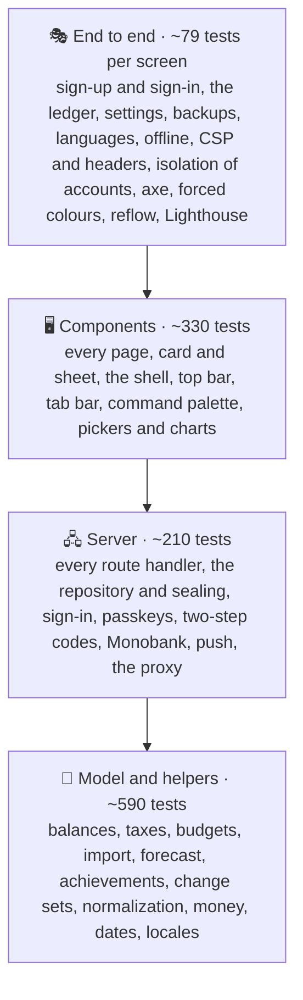
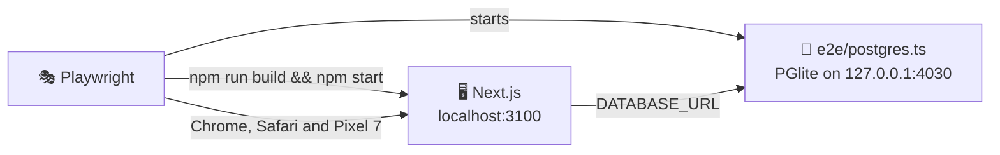

# 🧪 Testing

## 🧰 Stack

| Tool                            | Role                                                                  |
| ------------------------------- | --------------------------------------------------------------------- |
| ⚡ Vitest 5                     | Unit and component tests, configured in `vitest.config.ts`            |
| 🌐 jsdom 30                     | Browser-like environment for component tests                          |
| 🐙 Testing Library + user-event | Rendering components and driving them like a person                   |
| 🧩 jest-dom                     | Readable DOM assertions such as `toBeChecked()`                       |
| 📊 `@vitest/coverage-v8`        | Coverage reports and thresholds                                       |
| 🐘 PGlite                       | A throwaway Postgres in memory for the end-to-end tests               |
| 🎭 Playwright                   | End-to-end tests in Chromium and WebKit, on desktop and phone screens |
| ♿ axe-core                     | Accessibility checks inside the end-to-end tests                      |
| 🚦 Lighthouse                   | Performance, accessibility and best practices budget                  |

## ▶️ Running tests

| Command                 | Mode                                                                             |
| ----------------------- | -------------------------------------------------------------------------------- |
| `npm test`              | 👁️ Unit tests in watch mode                                                      |
| `npm run test:run`      | 🧪 Unit tests, single run                                                        |
| `npm run test:coverage` | 📊 Unit tests with coverage and thresholds                                       |
| `npm run test:e2e`      | 🎭 Production build on a throwaway database, then Playwright, axe and Lighthouse |

The HTML coverage report is written to `coverage/index.html`, the Playwright report to `playwright-report/`; open the latter with `npx playwright show-report`.

> [!IMPORTANT]
> Install the browsers for the end-to-end tests once with `npx playwright install chromium webkit`, or `make browsers`.

> [!CAUTION]
> No test ever reaches a real database. Unit tests answer every query with the fakes in `src/test/db.ts`, and the end-to-end tests start an empty Postgres in memory that is gone when they end. Never point `DATABASE_URL` of a test run at the development database: it may hold real money.

## 🔺 Shape of the suite



Most behaviour is pinned down by fast tests of pure functions of `AppState`; component tests render with the real messages and a test store and assert on what a person sees. The end-to-end tests check what only a real browser, server and database can: the sign-in gate, sealed records that come back, saves that merge between tabs, the nonce-based Content Security Policy, the service worker, layout on a phone and the accessibility of the finished pages.

## 📁 Where unit tests live

Tests sit next to the code they cover as `*.test.ts(x)`, and every component has its own file in its folder, for example `features/transactions/ui/LedgerCard/LedgerCard.test.tsx`:

| Area                | Files                                                                                                        | Covers                                                                                                                                                       |
| ------------------- | ------------------------------------------------------------------------------------------------------------ | ------------------------------------------------------------------------------------------------------------------------------------------------------------ |
| 🗄️ Data             | `features/data/**`                                                                                           | Defaults, normalization of every record, change sets and merging two devices, the IndexedDB outbox, the repository on its records table, resealing           |
| 💸 Money features   | `accounts`, `transactions`, `income`, `investments`, `forecast`, `reports`, `dashboard`, `calendar`          | Balances and net worth, debts and payoff, budgets and rollover, recurring rules, subscriptions, taxes and the tax calendar, returns, projections, CSV export |
| 📥 Import           | `features/import/**`                                                                                         | CSV parsing, Monobank statements and webhooks, duplicates, transfer pairing, rules learned from a correction                                                 |
| 🔐 Auth and profile | `features/auth/**`, `features/profile/**`                                                                    | Password hashing, the strength meter, TOTP against the RFC vectors, passkeys, sessions and sign-ins, achievements, the profile sheets                        |
| 🔔 Notifications    | `features/notifications/**`                                                                                  | Push encryption against the RFC 8291 example, VAPID, the push-service allow-list, the morning note, its clock, the offline page                              |
| 📈 Market           | `features/market/**`                                                                                         | Monobank and NBU rates, CoinGecko prices, the month's average rates, hourly refresh                                                                          |
| ⚙️ Settings         | `features/settings/**`                                                                                       | Preferences, categories and rules, backups in and out, the server error log                                                                                  |
| 🚀 App              | `app/api/**/route.test.ts`, `healthz`, `robots`, `StoreProvider`, `LocaleBridge`, `proxy`, `instrumentation` | Every handler without a session, with bad input, rate limits and the happy path; the store's saves, retries and undo; the sign-in gate and the nonce policy  |
| 🧰 Shared           | `shared/lib/*`, `shared/i18n/*`, `shared/hooks/*`, `shared/api/*`, `shared/ui/*/*.test.tsx`                  | Money, dates, guards, sealing, rate limiting, CSP, locales and catalogs, persisted views, the pool, every primitive                                          |
| 🧩 Widgets          | `widgets/*/*.test.tsx`                                                                                       | The shell with its skip link and database error, the top bar with its account menu, tab bar, phone top bar, brand, sync dot and footer                       |

## 🧪 Fixtures and helpers

| Helper                                    | File                   | Purpose                                                                                    |
| ----------------------------------------- | ---------------------- | ------------------------------------------------------------------------------------------ |
| `renderWithI18n(ui, locale)`              | `src/test/render.tsx`  | Renders inside `I18nProvider` with English or Ukrainian and returns `user`                 |
| `renderWithStore(ui, options)`            | `src/test/render.tsx`  | Renders with a test store and the messages; `probe` holds the latest state and undo labels |
| `answerQueries(query, handlers)`          | `src/test/db.ts`       | Answers each SQL statement with the first handler whose pattern matches                    |
| `result(rows)`, `statements(query)`       | `src/test/db.ts`       | A `pg` result, and the statements a fake ran, one line each                                |
| `request(path, method, body)`, `answerOf` | `src/test/http.ts`     | A `Request` for a route handler, and the JSON of its answer                                |
| `rect`, `resizeEntry`                     | `src/test/geometry.ts` | Boxes and resize entries for components that measure themselves                            |

`src/test/setup.ts` adds the jest-dom matchers, a `<dialog>` polyfill with modal focus, `matchMedia` and a `ResizeObserver` that reports 320 px (or an element's `data-width`), replaces `next/link` with a plain anchor, and unmounts components and clears `localStorage` and cookies after every test. `vitest.config.ts` only collects `src/**/*.test.{ts,tsx}` and aliases `server-only` to an empty module, so server code can be tested directly.

A server module that queries the database is tested with the pool replaced:

```ts
const db = vi.hoisted(() => ({ query: vi.fn<QueryFn>() }));

vi.mock("@/shared/api/db", () => ({
  getPool: () => ({ query: db.query }),
  ensureSchema: () => Promise.resolve(),
  withTransaction: <T>(work: (client: { query: QueryFn }) => Promise<T>) => work({ query: db.query }),
}));
```

Set `DATA_ENCRYPTION_KEY` with `vi.stubEnv` inside `vi.hoisted` when a test should seal and open records for real.

Vitest runs with `pool: "vmThreads"`: one jsdom per worker, and every test file in a fresh context of its own, which is about twice as fast as a new process per file. Built-in browser objects such as `location` cannot be redefined in that pool: wrap a call such as `location.reload()` in a small module and spy on that module instead.

Unit tests run without React Compiler, the same in all four apps, so coverage counts the branches of the source rather than the cache checks the compiler adds. The production build, the end-to-end tests and Lighthouse cover the compiled code.

## 🧭 Testing Next.js code

- 🛣️ **Route handlers** are called with a `Request` from `request()` and their `Response` is inspected. `auth()` is mocked per test, so every handler is tried without a session, with one, and with bad input.
- 🍪 **Request APIs** (`cookies()`, `headers()`) are mocked with `vi.mock("next/headers")`.
- 🧭 **Navigation** is mocked with `vi.mock("next/navigation")`: `router.push()`, `usePathname()` and `useSearchParams()`.
- 🌐 **Outside services** (Monobank, NBU, CoinGecko, Inzhur, push services) are reached through `fetch`, stubbed with `vi.stubGlobal` and routed by URL.
- ⏱️ **Timers**: the shared `Button` ignores a second click within 400 ms, so tests that click twice fake only `Date` (`vi.useFakeTimers({ toFake: ["Date"] })`) and move it on. A test that fakes `setTimeout` waits with `vi.advanceTimersByTimeAsync` and `vi.waitFor`, because Testing Library's `waitFor` stands still then.

## 🎭 End-to-end tests



`playwright.config.ts` starts two servers before the tests:

1. 🐘 **A throwaway Postgres** (`e2e/postgres.ts`): PGlite, Postgres compiled to WebAssembly, served over the Postgres protocol. It starts empty, the app applies `db/schema.sql` to it on boot, and it is gone when the run ends. PGlite is a single session, so the app keeps one connection (`DATABASE_POOL_MAX=1`).
2. 🖥️ **A production build** of the app on port 3100 with test-only keys, `OWNER_EMAIL` empty so every test can sign up, and the morning push clock off.

> [!TIP]
> Locally both servers are reused when they are already running, so after the first run a repeated `npx playwright test e2e/ledger.spec.ts` takes seconds. Start them yourself with the environment from `playwright.config.ts` to keep them between runs, or use `make dev-db` for the same database behind the dev server.

Every test that runs signed in gets an account of its own: the `test` fixture in `e2e/helpers.ts` registers a new email through the API and signs the browser in, so tests never share data and can run in parallel.

| Spec                       | Checks                                                                                                                                                                                                                                                                                   |
| -------------------------- | ---------------------------------------------------------------------------------------------------------------------------------------------------------------------------------------------------------------------------------------------------------------------------------------- |
| 🔐 `auth.spec.ts`          | Signing up on the page, signing in and a wrong password, the way back to the page asked for, a second account with the same email, signing out, and signing out every device                                                                                                             |
| 📒 `ledger.spec.ts`        | Adding, editing and deleting an entry with each step on the server, an expense filled from a photo of a fiscal receipt's QR code, an entry opened from the address, the command palette, an edit the server refused coming back after a reload, an entry added in another tab merging in |
| ⚙️ `settings.spec.ts`      | An account the dashboard counts, the theme after a reload, downloading a backup and reading it back in, a file that is not a backup                                                                                                                                                      |
| 🌍 `languages.spec.ts`     | Ukrainian and Czech browsers greeted in their language, a language picked before sign-in, the account's language on another device                                                                                                                                                       |
| 🧭 `routing.spec.ts`       | Every page with every text translated and no stray scrollbars, the sign-in page sending a signed-in visitor on, the old balance page, an entry opened and closed from the address                                                                                                        |
| ♿ `accessibility.spec.ts` | axe on every page, the sign-in pages, the dark theme, the dashboard in both appearances, the entry sheet and the palette, the keyboard alone, no sideways scrolling at 320 px, no word cut off at 360 px, forced colours                                                                 |
| 🛡️ `security.spec.ts`      | No console errors or CSP violations on any page, a fresh nonce and every header, one account never seeing another's data, `401` without a session, the health check, `security.txt`, flags that cannot run scripts                                                                       |
| ✈️ `offline.spec.ts`       | The offline page in the account's language when a reload fails, and the page coming back once online; the offline page in every language                                                                                                                                                 |
| 🔎 `seo.spec.ts`           | `noindex` everywhere and robots blocking all, a title for each page, the manifest and the shortcuts of the installed app                                                                                                                                                                 |
| 🙈 `privacy.spec.ts`       | With amounts hidden, no page shows a sum: not in text, axis labels, hidden chart tables, labels or tooltips                                                                                                                                                                              |
| 📸 `visual.spec.ts`        | Six pages with six months of data in both themes and on a phone, and the sign-in page, compared on Linux only                                                                                                                                                                            |
| 🚦 `lighthouse.spec.ts`    | The Lighthouse budget below                                                                                                                                                                                                                                                              |

`e2e/helpers.ts` holds what several specs share:

| Helper                    | Purpose                                                                                                                                                              |
| ------------------------- | -------------------------------------------------------------------------------------------------------------------------------------------------------------------- |
| `test`, `signUp(context)` | A test signed in to a new account, or a new account for any browser context; each sign-up comes from a made-up address, so the sign-up limit counts every test apart |
| `openPage(page, path)`    | Opens a page and waits until the account's data is shown                                                                                                             |
| `saved(page)`             | Waits until the latest change reached the server                                                                                                                     |
| `watchProblems(page)`     | Collects console errors and CSP violations and returns a check that expects none; Safari's `Load failed` for a request a navigation cancelled is allowed             |
| `clippedText(page)`       | Texts that end in an ellipsis or are cut by their box, skipping hidden and transparent ones; the 360 px check expects none                                           |
| `inTurn(items, step)`     | Runs steps one after another, as a person would                                                                                                                      |

The fixture answers every call to an outside service (Monobank, NBU, CoinGecko, Inzhur, Google) with steady figures, so the tests never leave the computer.

CI runs the browsers as two parallel jobs, `npx playwright test --project=lighthouse` for Chromium on desktop and phone with the visual tests and Lighthouse, and `npx playwright test --project=webkit`; both commands work locally too, as `make e2e-chromium` and `make e2e-webkit`.

Every spec except the visual tests and Lighthouse runs in **Desktop Chrome**, on a **Pixel 7** screen and in **Desktop Safari** on WebKit, the engine of every browser on Apple devices. The accessibility checks run with reduced motion, so transitions never catch axe halfway, and they also enable two axe rules that are off by default: `label-content-name-mismatch`, so a visible label always matches what voice control users say, and `target-size`, so every control is at least 24 × 24 px or far enough from its neighbours (WCAG 2.2, 2.5.8).

> [!NOTE]
> WebKit needs three workarounds. It restarts the page when a test asks for the push subscription, so the fixture removes `PushManager` there; its service worker sends every request past `page.route`, so the WebKit project runs without service workers, and only `offline.spec.ts` turns them back on; and on Linux, as on the CI runners, it browses with the user agent of Safari on Linux, because WebKit there paints without a GPU and the blurred glass of Apple devices would stall it.

### 📸 Visual tests

`e2e/visual.spec.ts` compares screenshots of the overview, Expenses, Reports, Accounts, Forecast and Settings with the files in `e2e/__screenshots__/`: the overview and Expenses in both themes, every page in the dark theme on a phone, and the sign-in page. The pages get a fixed account from `e2e/visual-state.ts` (three accounts, six months of entries, rent, two subscriptions, budgets, a deposit, a car loan and a loan to a friend), the clock stands at 15 September 2026, 10:00 Kyiv time, and the screenshot waits until the entrance animations and fonts are done. Fonts and anti-aliasing differ from one system to another, so screenshots are only taken and compared on the Linux runners of GitHub Actions: the `visual` project exists when `CI` or `VISUAL` is set, and the Chromium job of `e2e` runs it before Lighthouse.

1. 📸 After a change in the design, start the **Screenshots** workflow (`.github/workflows/screenshots.yml`) from the **Actions** tab.
2. 📥 Download its `screenshots` artifact and unpack it into `e2e/__screenshots__/`.
3. 📝 Commit the new files together with the change.

> [!NOTE]
> Until `e2e/__screenshots__/` exists, the visual tests load the pages without comparing anything (`ignoreSnapshots`). A screenshot may differ in at most 1% of its pixels, and the HTML report of a failed run shows the expected, the actual and the difference side by side.

### 🚦 Lighthouse budget

`lighthouse.spec.ts` runs after the other projects, one page at a time, in a fresh Chromium profile that signs up first where the page needs an account and marks its exchange rates fresh, so no page asks Monobank for rates during an audit and meets its limit of one request in five minutes:

| Page               | Form factor | Performance | Accessibility | Best practices | Page weight |
| ------------------ | ----------- | ----------: | ------------: | -------------: | ----------: |
| 🔐 `/login`        | 🖥️ Desktop  |      ≥ 0.90 |             1 |              1 |    ≤ 410 KB |
| 🔐 `/login`        | 📱 Mobile   |      ≥ 0.80 |             1 |              1 |    ≤ 410 KB |
| 🏠 `/`             | 🖥️ Desktop  |      ≥ 0.90 |             1 |              1 |    ≤ 490 KB |
| 📒 `/transactions` | 📱 Mobile   |      ≥ 0.80 |             1 |              1 |    ≤ 500 KB |

The sign-in page weighs about 375 KB locally, the dashboard about 455 KB and Expenses on a phone about 465 KB, counting the pages Next.js prefetches and the flow lines of the backdrop. Each page weight limit sits about 35 to 40 KB above what the page weighs today, the same rule in all four apps, so a heavier dependency or a bigger prefetch fails the build early; lower the limits again when a page gets lighter. SEO is not part of the budget: a private app that tells every search engine to stay away cannot score in it.

Every accessibility audit must pass as well, including the ones Lighthouse does not weigh into the score, and so must every weighted best practices audit (unweighted ones such as `valid-source-maps` cannot pass in a production build without source maps). Each run attaches the full Lighthouse HTML report to its test in the Playwright report, so a failed budget can be inspected in CI.

## 📐 Conventions

- 🎯 Query by role and accessible name (`getByRole("button", { name: "Save" })`). If something is hard to find this way, it is probably hard to use with a screen reader.
- 🖱️ Drive the UI with `userEvent`; use fake timers only for time-based behaviour, such as the save delay, the reminder clock or a toast that hides itself.
- 👀 Assert on what a person sees, the state the store ends with or the statements sent to the database, never on component state.
- 🔢 Keep logic that a component needs in a plain module in `model/` so it can be tested without rendering.
- 🧪 Type every mock: `vi.fn<(href: string) => void>()`, and build fixtures with their types instead of `as`. Oxlint requires both.
- 🌐 Never call a real outside service or database: stub `fetch` and the pool in unit tests and use the fixture and the throwaway database in end-to-end tests.

> [!CAUTION]
> Oxfmt rewrites escape sequences inside `String.raw` templates. Write expected strings with escapes such as `<` as ordinary string literals with a doubled backslash (`'\\u003c'`), or the test silently compares against the unescaped text.

## 📊 Coverage

`npm run test:coverage` fails below these thresholds:

| Metric        | Threshold |
| ------------- | --------: |
| 📄 Statements |      95 % |
| 🔀 Branches   |      87 % |
| 🧩 Functions  |      93 % |
| 📏 Lines      |      97 % |

The suite currently covers about 96.3 % of statements, 88.0 % of branches, 94.5 % of functions and 97.9 % of lines. Each threshold sits about a point below the current coverage, the same rule in all four apps, so a change can only keep or raise it; raise them again when new tests add a point. Next.js special files that only compose other components (`layout`, `page`, `error`, `global-error`, `global-not-found`, `not-found`, `manifest` and the app icon) are excluded, because the end-to-end tests and the production build cover them. CI publishes a coverage summary and uploads the HTML coverage and Playwright reports.
